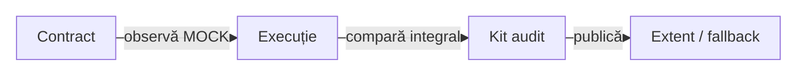
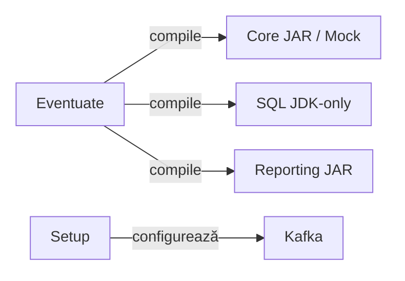

# ATF J2 — Eventuate, Kafka și framework de mesagerie · WIP

J2 compune teste Eventuate cu transport MOCK și infrastructură Kafka configurată
prin scripturi. Reporting este biblioteca J14 distribuită ca JAR/POM; sursa și
regresiile generice au owner în J0.

## ATF Java — prezentare executivă

Ținta este un framework de testare pentru cozi Kafka, cu un singur modul de test și Setup PowerShell în Podman. Există trei componente MOCK și trei SQL embedded Eventuate, plus biblioteca SQL generică și cinci invocări componente proprii. Observerul Kafka și citirile MySQL sunt probate real; aplicația completă cu CDC/saga rămâne NOT RUN.

| Intrare | Rezultat și limită |
|---|---|
| [Eventuate](atf-test-eventuate/README.md) | trei componente MOCK: API, convergență și mesagerie; trei componente SQL embedded: tranzacții, identitate și eșecuri |
| [Setup](atf-setup/README.md) | rețetă Kafka cu digest, readiness și producer/consumer; prerequisites ale hostului separate |
| [Atlas](docs/ATF_Context_Atlas.md) | intrări în cod, invarianti și dovezi, pentru context progresiv |
| [Scop J2](docs/ATF_J2_Scope.md) | catalogul explicit de opt module, fără UI/Debug sau Playwright |
| [SQL generic](atf-sql/README.md) | JDBC JDK-only, query/binds typed, captură bounded și rezultate imuabile; driver și verdict la consumer |
| [LIVE și infrastructură](docs/ATF_SQL_Live_Verification.md) | observer Kafka și MySQL reale, memorie limitată; proba sintetică nu certifică saga |
| [Feedback](docs/feedback/README.md) | numai restanțele J2 și efectele contractelor comune consumate |

## Diagramă de bază



<details>
<summary><strong>Legendă — comparație și dovadă</strong></summary>

Contractul și expected-ul aparțin testului. Core și Mock produc observația;
Kit evaluează comparația o singură dată. Reporting publică modelul deja evaluat,
cu preview implicit 240; renderarea nu decide verdictul business.

</details>

## Harta modulelor

POM-ul live declară opt module. J2 exclude Shop/AutoEx, UI și Debug UI;
Reporting rămâne bibliotecă externă.

| Zonă | Module | Rol în J2 |
|---|---|---|
| platformă activă | atf-test-kit, atf-mock, atf-sql, atf-validation, atf-console | contracte runner, transport, validare și diagnostic |
| infrastructură | atf-setup | scripturi Kafka; Maven nu instalează sau pornește servicii |
| aplicație | atf-test-eventuate | suport în main, componente/fixture-uri și adaptor JUnit în test |
| guvernanță | atf-tests | catalog, boundaries, documentație, selecții și identitatea JAR-ului |

### Consum



<details>
<summary><strong>Legendă — dependențe și infrastructură</strong></summary>

Muchiile compile sunt dependențe Maven. Setup operează infrastructura separat;
nu este un hook de test sau de build. Test Kit și JUnit sunt test-scoped în
consumer. POM-urile sunt autoritatea pentru muchiile complete.

</details>

### Verificare și guvernanță

- [Guvernanța](atf-tests/README.md) verifică deployment-ul real, fără a reduce catalogul când lipsește un modul.
- [Perimetrul fără browser](docs/ATF_J2_Scope.md) este protejat prin catalog explicit și probe negative; sync-ul nu restaurează modulele retrase.
- [Reporting Tests în J0](../atf_j0/atf-reporting-tests/README.md) păstrează regresiile bibliotecii; J2 verifică propriul adaptor pe JAR.

## Harta straturilor de test

| Nivel | Dovadă curentă sau criteriu |
|---|---|
| unit | primitivele platformei; fără obligativitatea raportului component/E2E |
| component | trei cazuri MOCK și trei SQL embedded, în două suite explicite; SETUP, TEST BODY și TEARDOWN auditabile |
| integration | observer Kafka și citiri SQL reale demonstrate; transportul durabil și aplicația Eventuate au criterii distincte |
| E2E | saga Eventuate, efecte SQL/CQRS și idempotency business; încă nedemonstrate |

Auditarea HTML-ului Extent/fallback în browser nu înseamnă testare UI de produs.
Nu există un journey Shop/AutoEx sau un magazin UI în deployment-ul J2.

## Model de evoluție și verificare

Expected-ul rămâne independent de observație. Promovarea de la MOCK la broker
real cere identitate corelată, witness independent și probe negative; un PASS
pe fixture nu este transferat ca acceptanță Kafka ori saga.

## Secvența executivă API → raport → audit

Dintr-un staging pregătit conform [procesului TMP](docs/ATF_Build_And_Execution_Safety.md):

```powershell
mvn -B -N validate
mvn -B -pl atf-test-eventuate -am -DskipTests install
mvn -B -pl atf-test-eventuate -Dtest=EventuateComponentSuite test
```

[Ghidul Eventuate](docs/ATF_Eventuate_Testing.md) descrie selecțiile și matricea
Extent/fallback. [Setup](atf-setup/README.md) rulează explicit din PowerShell;
o sesiune elevată pregătită în prealabil permite rularea silent.

## Coerență și modificări guvernate

- Build-ul, rapoartele și cache-urile agentului rămân în TMP; sursele se promovează numai după reconcilierea hash-urilor live.
- Reporting se repară în J0; platforma comună se reconciliază selectiv cu J1.
- Scopul J2 fără UI/Debug prevalează asupra unui mirror de surse sau documente din celelalte deployment-uri.

## Aprofundare pe module și contracte

[Arhitectură](docs/ATF_Architecture.md) · [testare](docs/ATF_Testing_Guide.md) ·
[atlas Reporting J6](docs/ATF_Reporting_Library_Atlas.md) · [verificări executate](docs/ATF_J2_Verification.md).

## Referințe normative

[Index documentație](docs/README.md) · [bune practici de cod](docs/README_Atf_CodeBestPractices.md) ·
[stil documentar](docs/README_Atf_DocumentationBestPractices.md) · [sync workspace](docs/ATF_Workspace_Synchronization.md).

## Core ca bibliotecă — owner și deployment

Acest consumer are 8 module sursă. Core C3 și Reporting J14 sunt biblioteci externe, câte o pereche JAR/POM direct în lib.

[Contractul Core C3](docs/ATF_Core_Consumer.md) separă sursa, publicarea și acceptanțele J1/J2.
Testele native se păstrează în J0, iar acceptanța pe binar rulează în TMP.

[Acceptanța istorică Reporting J8](docs/ATF_Reporting_J8_Verification.md) păstrează catalogul existent și istoricul J6/J7.

[Acceptanța JSON C2/J9](docs/ATF_JSON_Binary_Verification.md) separă sursa, JAR-ul, rendererele și limitele rămase.

[Reporting J10](docs/ATF_Reporting_J10_Verification.md) documentează disclosure-ul local, puntea binară și regresiile sursă/JAR.

[Reporting J12](docs/ATF_Reporting_J12_Verification.md) fixează profilul explicit al inspectorului, sursele de timing și indicatorul assertions; acceptanțele J11 rămân istorice.

## Core C3 — contract consolidat

[Verificarea Core C3](docs/ATF_Core_C3_Verification.md) leagă noua pereche JAR/POM de nativele sursă/JAR și de acceptanța fiecărui consumer. Acceptanța C3 a folosit Reporting J12; livrarea curentă Reporting este consemnată separat mai jos, cu preview 240 și oracole independente.

[Reporting J14](docs/ATF_Reporting_J14_Verification.md) păstrează PNG-urile integrale la publicare și expected/observed ACTION/OBSERVE colapsabile, cu preview 240. Core C3 rămâne identic; acceptanțele sursă/JAR și ale fiecărui consumer sunt consemnate separat.

| Contract J14 | Comportament păstrat |
|---|---|
| rând UI comun | ACTION/OBSERVE folosesc aceeași redacție, inclusiv titlul capturii |
| dovadă integrală | expected/observed conservă whitespace-ul capturat |
| audit | preview 240 și verdict original, fără reevaluare |
