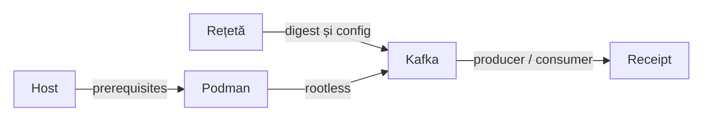

# ATF Setup — infrastructură reproductibilă

## Pe scurt

**WIP J2:** Kafka remote este validat din VM, prin CLI intern și client Java extern, individual și în două runde complete. Transportul durabil și reluarea după restart au [feedback separat](../docs/feedback/ATF_Setup_Feedback.md). Setup este infrastructură, iar `atf-test-eventuate` rămâne singurul modul de test.

Modulul deține instalarea și configurarea Kafka în Podman, prin scripturi
reutilizabile. Java și Podman sunt prerequisites ale hostului. Maven inventariază
modulul, fără instalare, drepturi administrative sau pornire de servicii.

| Boundary | Intrare și rezultat |
|---|---|
| prerequisites | [host](prerequisites/README.md): Java, PowerShell și client Podman; engine local WSL2 sau remote explicit |
| engine remote | [Setup-RemotePodman](Setup-RemotePodman.ps1): conexiune verificată, container real și receipts TMP |
| rețetă Kafka | [local.json](config/local.json): imagine cu digest, KRaft, listeners și resurse |
| Kafka remote | [profil](config/remote-kafka.json), [orchestrare](Setup-RemoteKafka.ps1): aceeași rețetă, engine și adresă externă explicite |
| gazdă fizică și VM | [pași și limite](prerequisites/README_Remote_Host.md): WSL2 pe fizic, host-only, API și forwarding Kafka distincte |
| execuție silent | [Setup.ps1](Setup.ps1): o sesiune elevată pentru prerequisites; loguri în TMP |
| probă reală | [Test-Kafka](scripts/Test-Kafka.ps1): mesaj corelat, topic/grup unic, partiție și offset |
| verificare offline | [contracte](tests/Test-SetupContracts.ps1): sintaxă, ownership și refuzul configurațiilor/erorilor |
| componente Setup | [probe controlate](tests/Test-SetupComponents.ps1): clock shift, diagnostic și contraexemple de acceptanță |

## Verificare offline

Într-o copie TMP, fără instalare sau pornire de servicii:

```powershell
./atf-setup/tests/Test-SetupContracts.ps1
```

Scriptul verifică parserul, configurația, ownership-ul, stdin/mediu și refuzurile proceselor; dovezile se scriu într-un director TMP nou. Un PASS offline nu certifică Podman ori Kafka.

```powershell
./atf-setup/tests/Test-SetupComponents.ps1
```

Componentele folosesc evenimente și receipts sintetice, declarate MOCK_SETUP_COMPONENT.
Fiecare comparație păstrează expected, actual și verdict în JSON; refuzurile includ cauza observată.
Rapoartele Extent/fallback ale componentelor Eventuate sunt verificate separat în [ghidul lor](../docs/ATF_Eventuate_Testing.md).

## Lansare silent

Dintr-o sesiune PowerShell 7.4+ deschisă ca administrator:

```powershell
./atf-setup/Setup.ps1 -InstallPrerequisites
```

- Elevarea aparține procesului PowerShell, nu permisiunilor folderului.
- Scripturile nu apelează RunAs, nu deschid ferestre și nu repornesc Windows.
- Lipsa drepturilor, restartul necesar ori engine-ul nefuncțional opresc execuția cu FAIL și dovezi păstrate.
- După prerequisites, reluați `Setup.ps1` fără switch.
- [Get-SetupStatus](scripts/Get-SetupStatus.ps1) păstrează boot-ul, componentele Windows, WSL, evenimentele hypervisorului și conexiunile Podman.
- Corelarea evenimentelor folosește ordinea înregistrărilor System după markerul de boot; fallback-ul CIM și erorile sunt declarate explicit.
- setup.json înregistrează inclusiv etapa FAIL; un eșec la Initialize-Podman oprește pașii Kafka.
- Pe gazda VirtualBox, [colectorul read-only](prerequisites/Get-VirtualBoxHostStatus.ps1) păstrează configurația și diagnosticul; nu modifică VM-ul.

## Podman remote din VM — traseul validat

Clientul Windows 5.8.3 folosește engine-ul Linux rootless 5.7.0 de pe gazdă,
prin tcp://192.168.56.1:8888. Profilul [remote-podman.json](config/remote-podman.json)
este separat de local.json; scripturile nu aleg implicit alt engine după un eșec WSL.

Din copia TMP, fără administrator dacă clientul este deja instalat:

```powershell
./atf-setup/Setup-RemotePodman.ps1
./atf-setup/tests/Test-RemotePodmanE2e.ps1
```

- [Initialize-RemotePodman](prerequisites/Initialize-RemotePodman.ps1) verifică versiunile, Linux amd64 și rootless; creează conexiunea atf-j2-host numai dacă lipsește și refuză un endpoint existent diferit.
- [Test-RemotePodman](scripts/Test-RemotePodman.ps1) execută hello-world cu digest fixat, nume/probeId unic, fără rețea în container; cere exit 0, output verificat și absența containerului după --rm.
- CLI-ul folosește URL-ul explicit la fiecare comandă de engine; o modificare concurentă a conexiunii numite nu redirecționează comenzile probei.
- Proba repetată cere două execuții noi, aceeași imagine și reutilizarea conexiunii; păstrează FAIL și rundele NOT_RUN la prima eroare.
- Mesajul Hello from Docker! aparține imaginii hello-world; engine-ul verificat este Podman.
- [Componentele remote](tests/Test-RemotePodmanComponents.ps1) verifică separat configurații, engine rootful/greșit și conexiuni străine; nu execută engine-ul.

TCP-ul acceptat este limitat în rețetă la 192.168.56.0/24. Regula firewall a
gazdei a fost declarată de operator ca host-only; scripturile guest nu o certifică.
Transportul este fără TLS/autentificare și servește acest laborator izolat;
[Podman recomandă autentificarea TLS pentru API publicat în rețea](https://docs.podman.io/en/v5.8.3/markdown/podman-system-service.1.html).

<details>
<summary><strong>Limita față de Setup local și Kafka</strong></summary>

Setup.ps1, Get-SetupStatus și Test-SetupE2e folosesc în continuare local.json
și WSL2 din guest. Traseul remote nu le rescrie și nu pretinde că repară WSL2.
Instalarea clientului absent rămâne la [Install-Podman](prerequisites/Install-Podman.ps1),
într-o sesiune deja elevată; ruta remote nu pornește instalări sau dialoguri.

Kafka publică 127.0.0.1:19092 pe hostul engine-ului, separat de loopback-ul
VM-ului. Profilul remote compune rețeta comună cu listenerul extern și
forwarding-ul fizic; Setup-RemotePodman rămâne numai proba engine-ului.

</details>

## Kafka remote — provisioning și client extern

[Ghidul fizic–VM](prerequisites/README_Remote_Host.md) explică ordinea completă,
inclusiv transferul scriptului și elevarea pe gazdă. Configurațiile și logurile
nu se transferă implicit între cele două sisteme.

```powershell
./atf-setup/scripts/Start-Kafka.ps1 -ConfigPath ./atf-setup/config/remote-kafka.json
./atf-setup/scripts/Test-Kafka.ps1 -ConfigPath ./atf-setup/config/remote-kafka.json -InternalOnly
```

| Probă | Ce cere pentru PASS |
|---|---|
| Start-Kafka | broker pregătit pe listenerul intern; imagine, owner/spec și identitate verificate |
| Test-Kafka -InternalOnly | livrare internă corelată; hostTcpReachable false, fără certificarea rutei guest |
| Test-Kafka implicit | livrare internă și conexiune TCP din caller la endpoint-ul configurat |
| [Test-KafkaExternal](scripts/Test-KafkaExternal.ps1) | client Java în Windows caller, metadata corectă, ack și consum pe aceeași partiție/offset |
| [două runde remote](tests/Test-RemoteKafkaE2e.ps1) | patru probe independente, aceeași resursă și toate etapele PASS |

După configurarea forwarding-ului pe fizic:

```powershell
./atf-setup/scripts/Test-KafkaExternal.ps1
./atf-setup/Setup-RemoteKafka.ps1
./atf-setup/tests/Test-RemoteKafkaE2e.ps1
```

- Profilul remote extinde rețeta locală; nu dublează comenzile de provisioning Kafka și nu mărește bugetul readiness de 60 s.
- API-ul Podman 8888 servește provisioning-ul; portul Kafka 19092 servește metadata și datele. Configurarea Kafka nu șterge API-ul.
- [Clientul de infrastructură](probes/java/KafkaExternalProbe.java) este compilat în TMP, în afara lifecycle-ului Maven; nu este clientul/observerul Eventuate din framework.
- [Rețeta clientului](config/kafka-client.json) și [validatorul](scripts/support/KafkaClient.psm1) verifică hash-urile JAR-urilor copiate din imagine înainte de execuția Java.
- [Componentele remote Kafka](tests/Test-RemoteKafkaComponents.ps1) refuză probe incomplete/replayed, listener greșit, lipsa ack-ului, payload necorelat și biblioteci corupte.

## Configurație și idempotency a provisioning-ului

Kafka 4.1.2 este fixat la digestul manifestului Linux amd64;
rețeaua și volumul au nume proprii și etichete owner/specification.

- Publicarea engine-ului este `127.0.0.1:19092`; metadata externă este loopback local sau `192.168.56.1:19092` remote, cu forwarding pe fizic.
- Listenerul intern rămâne `atf-j2-kafka:29092`.

- Reutilizarea cere owner, specificație și imagine identice; diferențele sunt refuzate.
- Nu există replace, prune, ștergere de volume ori migrare implicită.
- [Stop-Kafka](scripts/Stop-Kafka.ps1) oprește numai containerul verificat și păstrează datele/mașina.
- Readiness are un singur buget; limitele CLI din container evită clienți Java orfani.
- Producerul sincron cere acks=all și idempotence de transport; deduplicarea business rămâne un contract separat.
- Producerul folosește o conductă fixă fără exec -i, cu payload literal în argv, pipefail și timeout remote; eșecurile nu retrimit mesajul aceleiași probe.

## E2E de infrastructură locală

După deblocarea engine-ului, din copia TMP:

```powershell
./atf-setup/tests/Test-SetupE2e.ps1
```

Proba execută Setup de două ori și verifică aceeași identitate de container,
imagine și specificație, cu două mesaje independente și poziții observate.
Nu instalează prerequisites; prima eroare oprește fluxul, iar setup-e2e.json păstrează FAIL și runda neexecutată.

Acesta este E2E de infrastructură, cu loguri native și receipts JSON.
Profilul remote are orchestrat separat clientul Java extern; saga Eventuate
cu raport Extent rămâne alt nivel de acceptanță în [feedback](../docs/feedback/ATF_Setup_Feedback.md).

## Dovezi și limite

Fiecare comandă păstrează argumentele literale, exit code, durată, stdout și
stderr în TMP; directorul rezultatului trebuie să fie nou.
[Atlasul](../docs/ATF_Setup_Atlas.md) separă livrarea de acceptanța reală.

- Proba Kafka locală verifică TCP pe host și roundtrip pe listenerul intern; metadata negociată de clientul Java are criteriu separat în [feedback](../docs/feedback/ATF_Setup_Feedback.md).
- Topicurile probei au nume unice și retenție de o oră; metadatele rămân în broker, fără resetarea grupurilor aplicației.
- Importul WSL2 local a eșuat nativ cu HCS_E_HYPERV_NOT_INSTALLED; ruta remote păstrează acel diagnostic și verifică separat brokerul și accesul din VM.



<details>
<summary><strong>Legendă — provisioning și dovadă</strong></summary>

Hostul furnizează Java și engine-ul. Rețeta fixează imaginea și KRaft cu un
broker. Receipt-ul este dovadă de infrastructură, separat de MOCK și saga.

</details>
