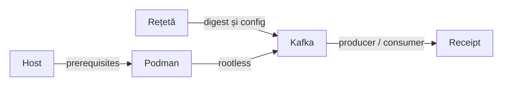

# ATF Setup — infrastructură locală reproductibilă

## Pe scurt

**WIP J2:** rețeta și verificările offline există; brokerul real și clientul Java au acceptanță separată în [feedback](../docs/feedback/ATF_Setup_Feedback.md). Setup este infrastructură, iar `atf-test-eventuate` rămâne singurul modul de test.

Modulul deține instalarea și configurarea Kafka în Podman, prin scripturi
reutilizabile. Java și Podman sunt prerequisites ale hostului. Maven inventariază
modulul, fără instalare, drepturi administrative sau pornire de servicii.

| Boundary | Intrare și rezultat |
|---|---|
| prerequisites | [host](prerequisites/README.md): Java, PowerShell, Podman și WSL2 funcțional |
| rețetă Kafka | [local.json](config/local.json): imagine cu digest, KRaft, listeners și resurse |
| execuție silent | [Setup.ps1](Setup.ps1): o sesiune elevată pentru prerequisites; loguri în TMP |
| probă reală | [Test-Kafka](scripts/Test-Kafka.ps1): mesaj corelat, topic/grup unic, partiție și offset |
| verificare offline | [contracte](tests/Test-SetupContracts.ps1): sintaxă, ownership și refuzul configurațiilor/erorilor |
| componente Setup | [probe controlate](tests/Test-SetupComponents.ps1): clock shift, diagnostic și contraexemple de acceptanță |

## Verificare offline

Într-o copie TMP, fără instalare sau pornire de servicii:

```powershell
./atf-setup/tests/Test-SetupContracts.ps1
```

Scriptul verifică parserul, configurația, ownership-ul, stdin/mediu și refuzurile proceselor; dovezile se scriu într-un director TMP nou. Un PASS offline nu certifică Podman ori Kafka.

```powershell
./atf-setup/tests/Test-SetupComponents.ps1
```

Componentele folosesc evenimente și receipts sintetice, declarate MOCK_SETUP_COMPONENT.
Fiecare comparație păstrează expected, actual și verdict în JSON; refuzurile includ cauza observată.
Rapoartele Extent/fallback ale componentelor Eventuate sunt verificate separat în [ghidul lor](../docs/ATF_Eventuate_Testing.md).

## Lansare silent

Dintr-o sesiune PowerShell 7.4+ deschisă ca administrator:

```powershell
./atf-setup/Setup.ps1 -InstallPrerequisites
```

- Elevarea aparține procesului PowerShell, nu permisiunilor folderului.
- Scripturile nu apelează RunAs, nu deschid ferestre și nu repornesc Windows.
- Lipsa drepturilor, restartul necesar ori engine-ul nefuncțional opresc execuția cu FAIL și dovezi păstrate.
- După prerequisites, reluați `Setup.ps1` fără switch.
- [Get-SetupStatus](scripts/Get-SetupStatus.ps1) păstrează boot-ul, componentele Windows, WSL, evenimentele hypervisorului și conexiunile Podman.
- Corelarea evenimentelor folosește ordinea înregistrărilor System după markerul de boot; fallback-ul CIM și erorile sunt declarate explicit.
- setup.json înregistrează inclusiv etapa FAIL; un eșec la Initialize-Podman oprește pașii Kafka.
- Pe gazda VirtualBox, [colectorul read-only](prerequisites/Get-VirtualBoxHostStatus.ps1) păstrează configurația și diagnosticul; nu modifică VM-ul.

## Configurație și idempotency a provisioning-ului

Kafka 4.1.2 este fixat la digestul manifestului Linux amd64. Portul extern
este `127.0.0.1:19092`; listenerul intern este `atf-j2-kafka:29092`.
Rețeaua și volumul au nume proprii și etichete owner/specification.

- Reutilizarea cere owner, specificație și imagine identice; diferențele sunt refuzate.
- Nu există replace, prune, ștergere de volume ori migrare implicită.
- [Stop-Kafka](scripts/Stop-Kafka.ps1) oprește numai containerul verificat și păstrează datele/mașina.
- Readiness are un singur buget; limitele CLI din container evită clienți Java orfani.
- Producerul sincron cere acks=all și idempotence de transport; deduplicarea business rămâne un contract separat.

## Prima probă E2E de infrastructură

După deblocarea engine-ului, din copia TMP:

```powershell
./atf-setup/tests/Test-SetupE2e.ps1
```

Proba execută Setup de două ori și verifică aceeași identitate de container,
imagine și specificație, cu două mesaje independente și poziții observate.
Nu instalează prerequisites; prima eroare oprește fluxul, iar setup-e2e.json păstrează FAIL și runda neexecutată.

Acesta este E2E de infrastructură, cu loguri native și receipts JSON.
Clientul Java pe listenerul extern și saga Eventuate cu raport Extent sunt
următoarele niveluri distincte din [feedback](../docs/feedback/ATF_Setup_Feedback.md).

## Dovezi și limite

Fiecare comandă păstrează argumentele literale, exit code, durată, stdout și
stderr în TMP. Directorul rezultatului trebuie să fie nou. Proba reală verifică
TCP pe host și roundtrip pe listenerul intern; metadata negociată de un client
Java pe host are criteriu separat în [feedback](../docs/feedback/ATF_Setup_Feedback.md).

Topicurile probei au nume unice și retenție de o oră; metadatele topicului
rămân în broker. Scripturile nu resetează grupurile aplicației.
[Atlasul](../docs/ATF_Setup_Atlas.md) separă livrarea de acceptanța reală.

După restartul din 2026-10-31, importul WSL2 a eșuat nativ cu
HCS_E_HYPERV_NOT_INSTALLED; engine-ul și Kafka rămân nevalidate.



<details>
<summary><strong>Legendă — provisioning și dovadă</strong></summary>

Hostul furnizează Java și engine-ul. Rețeta fixează imaginea și KRaft cu un
broker. Receipt-ul este dovadă de infrastructură, separat de MOCK și saga.

</details>
