# atf-sql — citiri JDBC bounded și dovezi imuabile

## Pe scurt

Modulul deține execuția unui SELECT parametrizat și captura rezultatului.
Runtime-ul folosește numai JDK 21: nu depinde de driver, Eventuate, Kit,
JUnit sau Reporting. Driverul și fabrica de conexiuni aparțin consumerului;
expected-ul și verdictul aparțin testului.

J2 adaugă explicit acest al optulea modul. Core C3 și Reporting J12 rămân
biblioteci externe; sursele și regresiile generice Reporting rămân în J0.

| Boundary | Contract |
|---|---|
| [SqlQuery](src/main/java/atf/sql/query/SqlQuery.java) | template separat de lista ordonată de parametri JDBC typed; fără interpolare |
| [SqlExecutor](src/main/java/atf/sql/execution/SqlExecutor.java) | conexiune nouă per citire, un buget monoton, o execuție și un callback |
| [SqlSnapshot](src/main/java/atf/sql/result/SqlSnapshot.java) | identitate, metadata ordonată, rânduri, outcome, timp și diagnostic |
| [SqlExecutionFailure](src/main/java/atf/sql/execution/SqlExecutionFailure.java) | cauza originală păstrată; execuția și publicarea au origini distincte |
| [SqlValues](src/main/java/atf/sql/value/SqlValues.java) | valori imuabile și cost de captură comun parametrilor și celulelor |
| [adaptorul de test](src/test/java/atf/sql/tests/support/SqlComponentExtension.java) | observations neutre și assertions standard prin API-ul JAR, fără renderer local |

```mermaid
%%{init: {"themeVariables":{"fontSize":"15px"},"themeCSS":".nodeLabel, .nodeLabel p { font-size: 15px !important; line-height: 1.35 !important; } .edgeLabel, .edgeLabel p { font-size: 12px !important; font-weight: 400 !important; line-height: 1.2 !important; } .edgeLabel .labelBkg, .edgeLabel p { background: transparent !important; } .edgeLabel foreignObject { transform: translateY(-18px); overflow: visible; } .node rect { rx: 6px; ry: 6px; }","flowchart":{"curve":"linear","nodeSpacing":24,"rankSpacing":40,"padding":10,"diagramPadding":16}}}%%
flowchart LR
    Query["Query + binds"] -->|o execuție| JDBC["JDBC independent"]
    JDBC -->|capturează| Facts["Snapshot imuabil"]
    Facts -->|callback| Consumer["Consumer / Kit"]
    Consumer -->|API public| Report["Reporting JAR"]
```



<details>
<summary><strong>Legendă — execuție, fapte și verdict</strong></summary>

Fabrica primește timpul rămas și configurează timeout-urile driverului.
Executorul nu primește conexiunea writerului și nu reexecută SQL pentru raport.
Snapshot-ul returnat este aceeași instanță publicată. Consumerul poate verifica
faptele prin Kit; Reporting proiectează comparațiile deja evaluate.
Muchiile reprezintă fluxul dovezii, nu dependențe Maven.

</details>

## Folosire și responsabilități

```java
try (var sql = new SqlExecutor(remaining -> openReadOnlyConnection(remaining), evidence::add)) {
    var query = new SqlQuery("SELECT amount FROM orders WHERE id = ?",
            List.of(new SqlParameter(JDBCType.BIGINT, orderId)));
    var captured = sql.query(query, Duration.ofSeconds(2)).requireComplete();
    // Testul compară captured cu un expected independent.
}
```

- `openReadOnlyConnection` este fabrica consumerului, nu un helper inclus în modul. Folosiți credențiale cu grant SELECT.
- `setReadOnly(true)` și confirmarea driverului sunt suplimentare, nu un sandbox SQL; API-ul nu oferă DML, dar nici nu parsează un dialect pentru a autoriza un template arbitrar. În LIVE, politica implicită este `REQUIRED`.
- H2 ignoră flag-ul read-only, astfel fixture-ul embedded alege explicit `REQUESTED`; această excepție nu devine implicită pentru MySQL.

| Fapt | Semnificație |
|---|---|
| `COMPLETE` | toate rândurile capturate, celule complete și închiderea resurselor confirmată |
| `INCOMPLETE` | limită de rânduri sau celule atinsă; `requireComplete()` refuză o comparație de rezultat integral |
| `FAILED` | execuție/cleanup eșuat, cu rândurile integral capturate anterior și aceeași cauză propagată |
| `resourcesClosed=false` | închiderea nu este confirmată; nu înseamnă automat o resursă rămasă deschisă |
| etichete duplicate | metadata și rândurile sunt liste; niciun label nu suprascrie altă coloană |
| NULL / text / numere | SQL NULL, textul `null`, șirul gol și DECIMAL exact rămân distincte |

- Byte arrays sunt copiate defensiv; obiectele JDBC mutabile nu ies din scope. Valorile temporale sunt `java.time`; tipurile necunoscute eșuează explicit.
- La eșec în mijlocul unui rând se păstrează rândurile complete anterioare, nu o matrice pretins completă. Un sink care eșuează după SELECT păstrează snapshot-ul `COMPLETE` și originea `PUBLICATION`, fără reclasificare sau replay.

## Bugete și limite

| Politică implicită | Limită |
|---|---:|
| rânduri | 1.000 |
| coloane | 128 |
| text per celulă | 16.384 caractere UTF-16 |
| binar per celulă | 16.384 bytes |
| payload agregat | 4.194.304 unități conservative, inclusiv query, binds, metadata și celule NULL |

- `SqlCaptureLimits` configurează captura JDBC, nu dimensiunea HTML. Driverul poate bufferiza intern; fetch size este un hint și consumerul configurează cursorul specific driverului.
- Bugetul exterior include conectarea și lectura; JDBC query timeout are granularitate în secunde. La expirare se încearcă anularea/abort-ul, executorul este invalidat și nu mai acceptă alt query.
- Închiderea workerului așteaptă cel mult o secundă și raportează cleanup încă neconfirmat. Nu există promisiunea că un driver care ignoră întreruperea a anulat operația pe server.

Parametrul `sensitive` este o indicație pentru publisher; snapshot-ul brut rămâne
dovadă în memorie. Nu logați valorile brute. Adaptorul de test maschează bind-urile
marcate și folosește redactorul JAR pentru proiecția publicată.

- Pașii SQL nativi și bugetele HTML distincte sunt cerute la [ownerul J0](../../atf_j0/docs/feedback/ATF_Reporting_Feedback.md). Preview-ul assertions rămâne **240**.
- Observațiile JSON actuale nu sunt prezentate ca un renderer SQL deja livrat.

## Verificare

Din staging TMP, cu cache Maven propriu:

```powershell
mvn -B -pl atf-sql -am "-Dtest=SqlQueryContractTest,SqlExecutorFailureTest,SqlComponentSuite" "-Dsurefire.failIfNoSpecifiedTests=false" test
```

[Suita finită](src/test/java/atf/sql/tests/suites/SqlComponentSuite.java) are trei
clase și cinci invocări: rezultate typed, tranzacții independente și limite/failure.
[Matricea artifactului](src/test/java/atf/sql/tests/support/acceptance/SqlReportAcceptance.java)
rulează clasele și suita în Extent/fallback, cu SQLException neconsumată controlată.
Oracolul verifică query, binds, celule, identitatea invocării și verdictul; mutanții
cu ID/query lipsă sau DECIMAL rotunjit trebuie respinși.

[Dovada incrementului](../docs/ATF_SQL_Live_Verification.md) separă H2, Kafka/MySQL
reale și aplicația Eventuate încă nevalidată. [Atlasul J2](../docs/ATF_Context_Atlas.md)
și [feedback-ul SQL](../docs/feedback/ATF_SQL_Feedback.md) sunt intrările de context.

## Limita diagnosticului

Mesajele Throwable și lista suppressed sunt separate de bugetul input/schema/celule. [SQL-DIAGNOSTIC-CAPTURE-120](../docs/feedback/ATF_SQL_Feedback.md#sql-diagnostic-capture-120--prioritate-82) delimitează proiecția bounded rămasă, păstrând cauza originală intactă.

## Inspecția explicită a rapoartelor SQL

[SqlExpectedProfiles](src/test/java/atf/sql/tests/support/acceptance/SqlExpectedProfiles.java) declară cinci metode, nouă capturi SQL și grupurile de assertions, individual sau prin suită. Eroarea JDBC neconsumată cere FAIL pe scenariu/fază; comparațiile care au trecut rămân PASS.

[Oracolul independent](src/test/java/atf/sql/tests/support/acceptance/SqlReportOracle.java) continuă să verifice query, binds, precizia DECIMAL, duplicatele, valorile typed și execution ID. Profilul explicit și mutantul de coloană sunt verificări suplimentare, fără dependență Reporting în runtime-ul SQL.
