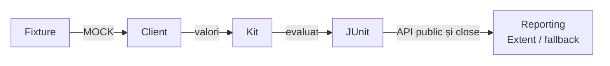
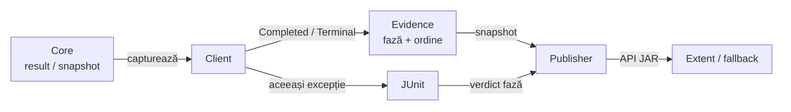

# atf-test-eventuate — mesagerie și Kafka · WIP

## Pe scurt

Acesta este singurul modul de test J2. Clientul/observerul Kafka al framework-ului este în lucru; [Setup](../atf-setup/README.md) are deja o probă Java de infrastructură validată pe broker real, separată de integrarea Eventuate.

Modulul compune platforma ATF cu trei oracole deterministe pentru Eventuate:
contract API, convergență cu retry de citire și validarea dovezilor de mesagerie.
Suportul reutilizabil este în main; adaptorul JUnit și fixture-urile sunt în test.

| Responsabilitate | Limită |
|---|---|
| Deține | clientul HTTP scriptat, deadline-ul de convergență, validatorul de dovezi și compoziția raportului |
| Kit | evaluarea unică a comparațiilor, lifecycle-ul fazelor și scope-ul class/suite |
| Reporting JAR | contractele publice, redacția, preview-ul, HTML-ul și navigarea Extent/fallback |
| Aplicația reală | saga, rezervarea creditului, deduplicarea, outbox-ul și proiecția CQRS; neexecutate în acest increment |



<details>
<summary><strong>Legendă — ownership și traseu</strong></summary>

Expected-ul este fixat de test, separat de răspunsul transportului ori de witness.
Kit decide verdictul înaintea redacției și a preview-ului; adaptorul transferă
rezultatul fără reevaluare. Muchiile descriu fluxul dovezii, nu dependențe Maven.

`Client` include clientul HTTP sau validatorul de mesagerie; `JUnit` este
adaptorul de lifecycle. `Reporting` publică la close artifactul HTML Extent ori
fallback, prin aceeași bibliotecă externă.

</details>

## Intrări și context

| Sursă | Rol în investigație |
|---|---|
| [EventuateApiClient](src/main/java/atf/eventuate/api/EventuateApiClient.java) | binding concret MOCK; POST o tentativă, GET 503 maximum două tentative prin Core |
| [OrderAwaiter](src/main/java/atf/eventuate/await/OrderAwaiter.java) | clock/pause injectate, buget unic și OrderContract integral; observațiile respinse rămân în istoric |
| [MessageEvidenceContract](src/main/java/atf/eventuate/validation/MessageEvidenceContract.java) | identitate, livrări distincte și witness independent; nu implementează deduplicarea aplicației |
| [ComponentReportRun](src/main/java/atf/eventuate/reporting/ComponentReportRun.java) | owner serial, configurație capturată, trei faze și publicare la close |
| [EventuateComponentExtension](src/test/java/atf/eventuate/tests/support/EventuateComponentExtension.java) | scope class/suite, collector per invocare; calea absolută numai după publicare |
| [EventuateComponentSuite](src/test/java/atf/eventuate/tests/suites/EventuateComponentSuite.java) | selectează exact cele trei clase, fără execuție paralelă |

## Invariante

- Expected-ul și observația au surse independente.
- Transportul este finit și ordonat; o rută absentă sau consumată nu produce răspuns verde.
- Faptele se păstrează înaintea redactării și a previzualizării.
- Excepția inițială rămâne distinctă de publicare și cleanup.
- Un assertion FAIL deja înregistrat nu devine încă un diagnostic execution identic.
- `MOCK_EVENT_FEED` și ordinalul fixture-ului nu reprezintă un offset Kafka.
- Output-ul intermediar rămâne în staging TMP.

## Verificare și navigare

Din rădăcina copiei TMP:

```powershell
mvn -B -pl atf-test-eventuate -am "-Dtest=EventuateComponentSuite" "-Dsurefire.failIfNoSpecifiedTests=false" test
```

Comanda execută cele trei componente MOCK și produce un raport comun; nu pornește Podman sau Kafka. [Matricea raportului](../docs/ATF_Eventuate_Testing.md#acceptanța-raportului) verifică separat individual/suită, Extent/fallback și failure-uri controlate.

[Atlasul J2](../docs/ATF_Context_Atlas.md) identifică ownerul și proba.
[Ghidul testării](../docs/ATF_Testing_Guide.md) separă componentele mock de acceptanța aplicației reale.

## Snapshot-uri terminale și faze

Clientul publică un rezultat Completed sau un Terminal cu snapshot-ul Core și
aceeași excepție originală. Terminal nu fabrică răspuns HTTP; lipsa răspunsului
rămâne explicită în proiecția bibliotecii.

| Boundary | Contract |
|---|---|
| EventuateApiClient | un singur callback per execuție; eroarea capturării devine suppressed, fără reexecuție |
| EventuateExchange | sumă typed Completed / Terminal; request, provenance și response availability provin din Core |
| EventuateEvidence | ordine per invocare și fază; entries include ambele variante, exchanges este numai proiecția Completed compatibilă |
| adaptor JUnit | scope SETUP și TEARDOWN restaurat după excepții; TEST BODY este faza implicită |
| publisher | publică fiecare intrare în faza sa, inclusiv când body-ul nu pornește; păstrează tentativele și timpul capturat |
| assertions audit | status derivat din comparații; eroarea execuției rămâne pe fază/request, fără a marca FAIL comparațiile trecute |
| verdict | excepția neconsumată produce FAIL; o excepție așteptată și verificată prin assertions păstrează PASS-ul testului și faptele transportului |



<details>
<summary><strong>Legendă — fapte capturate și verdict independent</strong></summary>

- Clientul capturează snapshot-ul înainte să propage excepția; callback-ul pentru Completed este separat de catch-ul execuției.
- Collectorul rămâne serial și local invocării; scope-ul fazei nu transferă ownership între thread-uri asincrone.
- HTTP evidence source reflectă provenance-ul capturat; NO_HTTP_EXECUTION nu certifică sursa evenimentelor de mesagerie.
- Request-ul terminal păstrează cauza și outcome-ul; callback-ul de finalizare folosește verdictul fazei, fără să transforme o excepție așteptată în test FAIL.
- Indexul Fails poate prezenta diagnosticul și execuția ca dovezi distincte; snapshot-ul request-ului este publicat o singură dată.

</details>

[Regresia terminală](src/test/java/atf/eventuate/tests/unit/EventuateTerminalEvidenceTest.java)
și [acceptanța artifactului](../docs/ATF_Eventuate_Testing.md#snapshot-terminal--acceptanță-consumer)
protejează cauza originală, faza, lipsa răspunsului și nominalele existente.
## Limite curente ale scaffold-ului

| Criteriu rămas | Owner și probă de închidere |
|---|---|
| identitate și deadline | [convergență](../docs/feedback/ATF_Eventuate_Feedback.md#evt-convergence-contract-86--identitate-și-deadline-real): identitatea și overflow sunt protejate; rămâne propagarea bugetului către citirea bounded LIVE |
| notificare consolă | [politica căii](../docs/feedback/ATF_Eventuate_Feedback.md#evt-console-path-79--prioritate-79): adaptorul emite direct calea și ocolește console.enabled |

Identitatea integrală și decodarea fără overflow au regresii în [EventuateOrderContractTest](src/test/java/atf/eventuate/tests/unit/EventuateOrderContractTest.java) și în componenta de convergență. API-ul await primește OrderContract, nu o stare izolată. ID-ul, starea și rejectionReason trebuie să corespundă în aceeași observație; istoricul păstrează observațiile respinse.

Celelalte criterii de mai sus și integrarea Kafka reală rămân deschise.
