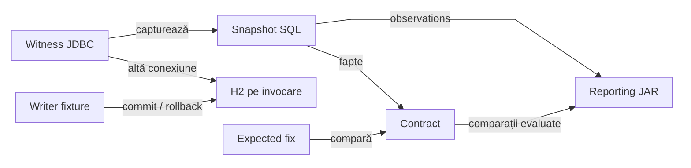

# SQL Eventuate — witness JDBC și H2 embedded

## Pe scurt

Acest pachet main citește efecte prin JDBC și evaluează separat un expected
independent. H2 2.5.252, schema și writerul aparțin testelor; adaptorul nu
importă driverul și nu implementează saga sau deduplicarea aplicației.

| Intrare | Responsabilitate |
|---|---|
| [OrderEffectsReader](OrderEffectsReader.java) | port read-only, cu SQLException originală |
| [JdbcOrderEffectsReader](JdbcOrderEffectsReader.java) | conexiune nouă, un SELECT parametrizat, închidere completă; fără retry sau mutații |
| [SqlEffectsSnapshot](SqlEffectsSnapshot.java) | ID cerut, witness ID opac, SQL_EMBEDDED, rânduri imutabile, timp și failure typed |
| [ReservationEffectContract](ReservationEffectContract.java) | identitate, exact un efect, credit BigDecimal și stare; un snapshot incomplet nu poate trece |

<strong>Legendă — independența witness-ului și limitele dovezii</strong>

- Writerul creează datele fixture-ului; witness-ul nu citește lista sa din memorie și nu calculează expected-ul din SQL.
- Fiecare read deschide conexiune nouă și execută SELECT cu order_id parametrizat, în ordine reservation_id. Schema atf_order_reservations este fixture ATF, nu schema upstream Eventuate.
- Rezultatul este publicat după închiderea ResultSet, statement și conexiunii. La eșec rămân rândurile deja citite, cu outcome FAILED; nu sunt un rezultat complet gol sau PASS.
- Try-with-resources păstrează aceeași excepție și cauza ei, cu cleanup suppressed. Collectorul este invocat o dată; eroarea sa devine secundară dacă SQL a eșuat, fără replay.
- După un read reușit, eroarea collectorului se propagă fără reclasificare SQL. Snapshot-ul capturat rămâne COMPLETE.
- SQL elapsed măsoară deschiderea conexiunii, SELECT-ul și închiderea resurselor, până la captură; nu include collectorul sau randarea. Timing-ul întregii faze rămâne dovadă distinctă.
- Provenance-ul este explicit la compoziție și rămâne SQL_EMBEDDED. El descrie adaptorul testat; nu certifică un DataSource arbitrar drept local sau aplicația reală.

## Tranzacție și durată de viață

Fixture-ul test-scoped păstrează o conexiune writer într-o bază numită unic
`jdbc:h2:mem:atf_j2_<run>`. Readerul folosește alt DataSource cu IFEXISTS=TRUE;
o bază închisă sau absentă eșuează, fără creare implicită.

- Writerul folosește tranzacție explicită; componenta verifică invizibilitatea înainte de commit și păstrarea unui singur efect după rollback.
- Ultima conexiune owner este închisă la cleanup, cu rollback al lucrului necomis. Nu există DB_CLOSE_DELAY=-1, port TCP, fișier persistent ori reset global.
- Două fixture-uri cu același order ID au baze distincte. Contorii de conexiuni, SELECT și close verifică lipsa replay-ului și a conexiunilor rămase deschise.
- DECIMAL(30,2) este citit prin getBigDecimal; oraclele compară numeric și păstrează valorile mari integral. Două rezervări pentru același order ID sunt permise intenționat pentru controlul negativ.

[H2 documentează modul in-memory și IFEXISTS](https://h2database.github.io/html/features.html).
Aceste teste verifică adaptorul și oraclele locale; baza aplicației, dialectul
ei, Kafka, CDC și deduplicarea business rămân acceptanțe separate.

## Navigare și verificare

[README-ul modulului](../../../../../../README.md) indică suita și matricea
Extent/fallback. Probele acoperă commit/rollback, identitate, duplicate, sume,
stări, baze izolate, SQL real invalid, fault JDBC după primul rând, cleanup și sink.

Observations neutre păstrează faptele; Component assertions păstrează cele
patru coloane și verdictul comparațiilor. J8 deține HTML, redacția și preview-ul
240; publisherul nu fabrică schimb HTTP pentru un SELECT.
