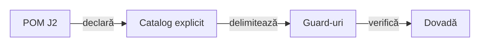
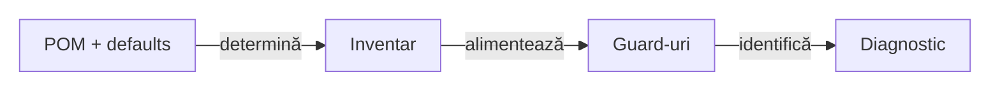

# ATF Tests — guvernanța deployment-ului J2

## Pe scurt

J2 verifică șapte module Eventuate, fără UI/Debug sau Playwright. Guvernanța
protejează platforma, selecțiile, documentele și integritatea Reporting JAR;
testele de produs aparțin consumerului Eventuate.

**Trasee rapide:** [Whole-ATF](#suita-whole-atf-și-reziduul-de-compatibilitate) · [Inventar](#inventarul-comun-al-surselor-java) · [Control Git](#guvernanța-schimbării-testelor) · [Rulare](#rulare-și-staging).



<details>
<summary><strong>Legendă — protecție fără ownership de produs</strong></summary>

POM-ul declară deployment-ul, iar catalogul fixează modulele obligatorii.
Guard-urile verifică sursele și documentele aplicabile; nu decid rezultatul
business și nu mută rendererul Reporting în guvernanță.

</details>

## Alege gate-ul după schimbare

| Schimbare | Intrare | Limită |
|---|---|---|
| README, atlas, feedback | documentation.* | structură, linkuri, proză, diagrame și afirmațiile factuale delimitate |
| Java, POM, source-set | WholeAtfGovernanceSuiteTest | arhitectură, ownership, inventar și deployment |
| test protejat | changes.* și testChanges | autorizarea diff-ului nu execută automat comanda proof |
| contract Eventuate / artifact | testele consumerului | suplimentar față de guvernanța structurală |

## Guvernanța deployment-ului sursă sau binar

| Deployment | Module | Contract |
|---|---:|---|
| sursă J0 | 12 | implementare și regresii Reporting native |
| journeys J1 | 9 | consumeri Shop/AutoEx și Reporting JAR |
| foundation | 7 / 8 | Core binar, fără / cu harness Reporting; alt catalog decât Eventuate |
| eventuate J2 | 7 | patru module platformă, Setup, Eventuate și Tests; Core/Reporting binare, fără browser |

[Resolverul comun](src/test/java/atf/api/tests/governance/distribution/README.md)
și [guard-ul J2](src/test/java/atf/j2/governance/J2DeploymentGovernanceTest.java)
refuză modulul obligatoriu lipsă, sursa shadow și dependențele browser.
Catalogul nu se micșorează după directoarele găsite.

Reporting binar este verificat prin coordonată, JAR/POM, CodeSource, hash,
POM embedded și independența de ATF. Catalogul testelor native din proveniență
nu este prezentat ca o execuție locală a sursei Reporting.

## Suita whole-ATF și reziduul de compatibilitate

`WholeAtfGovernanceSuiteTest` selectează explicit guard-urile platformei,
documentației, Git și J2. Geometria și adaptorul UI de compatibilitate sunt
externe acestui deployment; probele lor rămân în J0/J1.

| Grup | Owner executabil | Ce protejează |
|---|---|---|
| module și ownership | ArchitectureModuleBoundaryTest, ArchitectureOwnershipBoundaryTest | POM, package roots, interdicții și clasa exactă din JAR |
| coeziune și constante | AtfPackageCohesionGovernanceTest, ConstantsOwnershipGovernanceTest | maximum opt clase/pachet guvernat și vocabular la owner |
| lizibilitate și niveluri | AtfSourceReadabilityGovernanceTest, layers.* | inventar main/test, nivelul clasei executabile și suite disjuncte |
| consumer | consumers.* și atf.j2.governance.* | suport main versus teste, audit și selecțiile explicite ale celor trei componente MOCK și trei SQL embedded |
| documentație | documentation.* | aceleași validatoare pentru întregul scope și țintele adnotate |
| schimbarea testelor | changes.* | diff Git real și control eligibil per path |

J2 are două suite disjuncte Eventuate: MOCK și SQL embedded. Catalogul SQL verifică și driverul test-scoped și absența API H2 din main. Convenția celor trei suite
web din J1 nu se prezintă drept selecție locală J2; integrarea și E2E reale
rămân criterii deschise în [feedback](../docs/feedback/ATF_Eventuate_Feedback.md).

## Inventarul comun al surselor Java

`layers.AtfJavaSourceInventory` citește sourceDirectory/testSourceDirectory
din fiecare POM, cu default-urile Maven. Produce un set ordonat fără duplicate;
nu substituie effective POM, moștenirea sau activarea profilelor.



<details>
<summary><strong>Legendă — inventarul și limita sa actuală</strong></summary>

POM-ul stabilește rădăcinile; overlap-ul nu dublează fișierele. O rădăcină
ieșită din modul, XML nesigur sau expresie nerezolvată este refuzată.
Output-urile generate sunt separate de sursa declarată.

</details>

Descoperirea POM-urilor oprește traversarea output-urilor `target`, `artifacts`,
`.tmp` și `.git`; rădăcinile Java declarate sunt apoi parcurse integral.
Numele legal al unui package nu exclude sursa compilabilă.

[Proba inventarului](src/test/java/atf/api/tests/governance/AtfSourceReadabilityGovernanceTest.java)
compilează independent patru surse, inclusiv package-uri `target`/`artifacts`,
și cere detectarea încălcării din fiecare fișier.

### Două inventare cu responsabilități distincte

| Intrare | Contract |
|---|---|
| inventarul `layers` din ATF Tests | selecție literală main/test din POM pentru guard-urile Maven; output-ul modulului este exclus înainte de descoperire |
| inventarul `core.files` | grupează package-urile unei rădăcini deja selectate; nu demonstrează acoperirea inventarului Maven |

### Proveniența surselor platformei J2

[Manifestul platformei](../platform-provenance.json) păstrează în `files`
amprenta efectivă a fiecărei surse importate, iar `reconciliations` păstrează
amprenta anterioară și cea nouă pentru incrementul revizuit.

| Moment | Control |
|---|---|
| import nou sau corecție comună | importul compară ownerul J1; implementarea locală J2 păstrează previousSha256, noul hash și scope propriu, fără a certifica implicit J0/J1; fără rehash global |
| relocare de probe J2 | files conține calea curentă; reconcilierea păstrează previousPath și cele două hash-uri; dovada compară corpurile testelor și execută aceleași cazuri, fără excepție de coeziune |
| acceptanță J2 | `J2DeploymentGovernanceTest` cere toate amprentele efective și profilul fără module browser; un import neconsemnat produce FAIL |
| Reporting JAR | `library-provenance.json` rămâne dovada binarului original; ledgerul surselor platformei nu o rescrie |

Controalele testChanges și proba fiecărui owner rămân obligatorii. Actualizarea
manifestului consemnează o reconciliere demonstrată; nu certifică implicit
brokerul ori scenariile business și nu înlocuiește testele comportamentale.

## Guvernanța schimbării testelor

Testele din modulele ATF se schimbă prin controale tehnice structurate, legate
de cerința ownerului. Singura
excepție este `atf-test-practice-shop`; limita
de coeziune și celelalte reguli de arhitectură continuă să i se aplice.

| Control | Regulă |
|---|---|
| Scope | toate fișierele din `<modul>/src/test/`, inclusiv suport, resurse și suite; `pom.xml` rădăcină și POM-urile modulelor, cu excepția exactă Shop |
| Cerere/control | bloc YAML `testChanges`, ID unic, `ACTIVE` în feedback-ul ownerului sau `VERIFIED` în baseline, motiv, comandă Maven de probă, expirare și SHA-ul baseline-ului |
| Fișiere | căi relative exacte; fără wildcard, traversal sau owneri multipli pentru aceeași schimbare |
| Ștergere / redenumire | `allowDelete: true` pentru vechea cale; redenumirea este evaluată ca ștergere + adăugare |
| Diferență Git | committed față de baseline, staged, unstaged și fișiere noi; nici testele noi ignorate de Git nu sunt exceptate |
| Eșec infrastructură | checkout sau baseline invalid, conflict ori YAML invalid produc FAIL, nu skip |

`TestChangeGovernanceTest`, `TestChangePolicyTest` și `GitTestChangesTest` sunt
incluse în `WholeAtfGovernanceSuiteTest`. Probe negative verifică cereri lipsă,
închise, expirate, incomplete, cu baseline străin, duplicate și ștergeri
neautorizate; fixture-ul Git real verifică și nume cu spații și redenumiri.

La lansare locală, inclusiv IntelliJ, baza implicită este `HEAD`. Pentru o
ramură completă se setează `-Datf.governance.testChanges.baseRef=<review-base>`;
CI cere explicit această proprietate sau `ATF_TEST_CHANGE_BASE_REF` și refuză
valoarea literală `HEAD`. Baza trebuie să fie un strămoș al commitului curent;
cererea fixează SHA-ul rezolvat, nu un ref mobil.

### Documente și responsabilități

DocumentationLinkGovernanceTest și probele ancorelor verifică README-uri,
atlase, contracte și feedback, inclusiv fragmente Unicode și ancore explicite.
Existența țintei nu certifică sensul etichetei sau toate afirmațiile prozei.

| Afirmație factuală locală | Sursă | Refuz |
|---|---|---|
| numărul modulelor | POM rădăcină versus ATF_Architecture | valoare absentă, duplicată sau greșită |
| scope Kit / consumer absent | POM-ul direct al deployment-ului | scope greșit sau absență declarată incorect |
| profil J2 și ownership | catalog, proveniență și atlas | restaurare UI, owner Reporting sau catalog eronat |

Geometria numerică UI este verificată la ownerii J0/J1. J2 păstrează
guard-urile build-ului și țintele documentare mapate explicit, fără skip după
absența unui README activ.

| Informație | Owner documentar |
|---|---|
| cerință neînchisă și control ACTIVE | feedback-ul ownerului din docs/feedback |
| control VERIFIED încă necesar diff-ului | docs/ATF_Test_Changes_Baseline.md |
| comportament stabil demonstrat | README-ul sau contractul ownerului |

Parserul citește YAML din feedback și baseline, inclusiv details închis.
Un control istoric eligibil nu se șterge doar fiindcă implementarea există;
se verifică mai întâi diferența față de baza Git reală.

<details>
<summary><strong>Schema controlului și efectul câmpurilor</strong></summary>

| Câmp | Contract executabil |
|---|---|
| `id` | identificator unic între toate documentele citite, inclusiv intrările neeligibile |
| `status` | `ACTIVE` și `VERIFIED` pot fi eligibile; `DRAFT` și `CLOSED` nu autorizează schimbarea |
| `base` | SHA imutabil, egal cu baza rezolvată pentru rularea gate-ului |
| `expires` | dată ISO; controlul este eligibil inclusiv în acea zi |
| `reason` | text de minimum 20 de caractere care explică schimbarea |
| `proof` | comandă Maven `test` sau `verify` declarată, executată separat de gate |
| `paths` | listă nevidă de căi protejate, relative exacte și distincte în control |
| `allowDelete` | boolean opțional, implicit `false`; `true` pentru o ștergere |

- Blocul YAML are o singură cheie `testChanges` și o listă nevidă; câmpurile
  necunoscute și cheile duplicate sunt respinse.
- Un ID nu se copiază la transfer; între controalele eligibile, fiecare path
  schimbat are un singur owner pentru baza și data rulării.
- Guvernanța citește și YAML-ul din `<details>` închis implicit; vizibilitatea
  Markdown nu schimbă eligibilitatea.

</details>

### Reconciliere și închidere

1. Inspectează sursele live, criteriul funcțional și diferența față de baza revizuirii.
2. Înregistrează controlul `ACTIVE` în feedback-ul ownerului, cu path-uri exacte, înaintea modificării protejate.
3. Rulează proba relevantă și gate-ul în [staging extern cu Git real](../docs/ATF_Build_And_Execution_Safety.md#staging-pentru-guvernanța-schimbării-testelor); rendererul cere și verificarea randării.
4. Promovează contractul demonstrat la owner; elimină din feedback numai criteriul îndeplinit.
5. Mută controlul în baseline-ul `VERIFIED` dacă diff-ul încă îl cere, păstrând ID-ul și eliminând blocul `ACTIVE` din feedback.
6. Elimină controlul când baza folosită de gate nu mai raportează schimbările acoperite; verifică din nou corespondența diff–control.

`VERIFIED` atestă incrementul verificat, separat de acceptanța întregii cerințe.
Gate-ul validează metadatele și corespondența diff–control; comenzile `proof`
se execută separat, iar aprobarea unei schimbări de regulă rămâne explicită.

La expirare sau schimbarea bazei se revizuiesc perimetrul și dovada înaintea
actualizării controlului. Controalele active nu au un fișier dedicat: ele stau
în feedback-ul ownerului numai cât timp sunt necesare; procedura rămâne aici, iar
indexul `docs/feedback/README.md` se păstrează permanent.

## Guvernanța detaliilor la consolă

ConsoleDefaultsGovernanceTest protejează proiecția și default-urile aplicabile
modulelor prezente. Wiring-ul browser și scenariile Shop rămân externe J2;
testele Console verifică separat comportamentul lor local.

## Module consumatoare separate

[Eventuate](../atf-test-eventuate/README.md) deține clientul, convergența,
witness-ul, expected-urile și adaptorul JUnit. [Setup](../atf-setup/README.md)
deține provisioning-ul și probele proceselor, fără verdict saga.

Reporting și regresiile generice aparțin J0; Shop/AutoEx și runtime-ul browser
aparțin J1. Aceste domenii nu devin module J2 prin sincronizarea documentației.

## Rulare și staging

Într-un [staging extern cu Git real](../docs/ATF_Build_And_Execution_Safety.md#staging-pentru-guvernanța-schimbării-testelor):

```powershell
mvn -B -pl atf-tests -am "-Dtest=WholeAtfGovernanceSuiteTest" "-Dsurefire.failIfNoSpecifiedTests=false" test
mvn -B -pl atf-tests -am "-Dtest=DocumentationTargetGovernanceTest,J2DocumentationGovernanceTest" "-Dsurefire.failIfNoSpecifiedTests=false" test
```

Pentru review-ul unei ramuri adaugă baza reală testChanges. Rularea nu mută
rapoarte, cache sau target peste live și nu oprește execuții paralele.

## Regula responsabilităților

| Suprafață | Owner |
|---|---|
| reactor, arhitectură, documente și gate Git | atf-tests |
| produs și oracle Eventuate | atf-test-eventuate |
| infrastructură Kafka / prerequisites | atf-setup |
| renderer / API public Reporting | J0 atf-reporting |
| regresii generice Reporting | J0 atf-reporting-tests |

### Linkuri README către secțiuni

Indexul de ancore păstrează Unicode, heading-uri duplicate și ancore HTML
explicite; ignoră exemplele din fences. Fragmentele inexistente rămân erori,
inclusiv când documentul vizat nu se numește README.

## Verificare rapidă

- Citește [scopul J2](../docs/ATF_J2_Scope.md), baza Git și sursa actuală înaintea schimbării.
- Rulează gate-ul ownerului și proba comportamentală relevantă; proof nu se execută automat prin parser.
- Închide feedback-ul numai cu dovada cerută; păstrează contractul stabil și limitele în [atlas](../docs/ATF_Context_Atlas.md).
