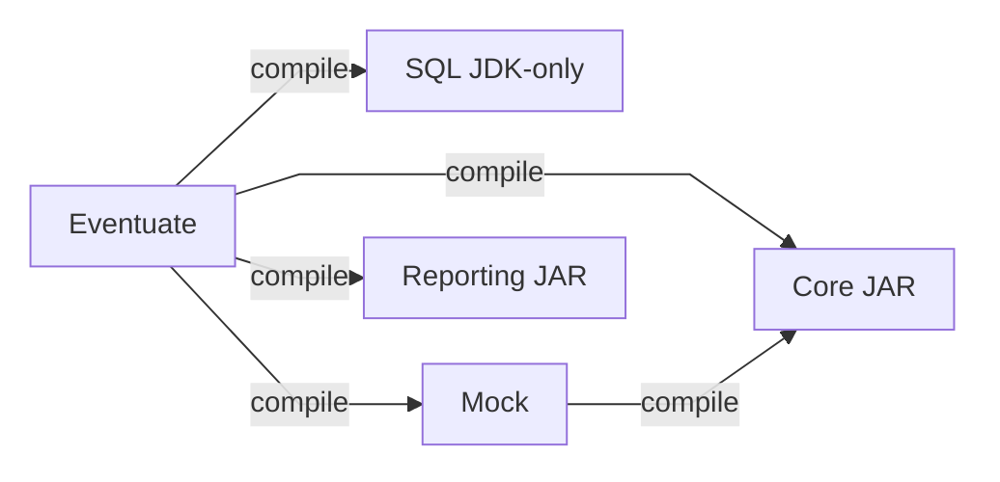

# Arhitectura ATF J2 — Kafka și mesagerie · WIP

## Pe scurt

Ținta este un framework Kafka/mesagerie cu un singur modul de test și Setup PowerShell în Podman. Observerul framework-ului este probat pe Kafka real, iar SQL generic pe H2/MySQL; acceptanța aplicației Eventuate complete rămâne NOT RUN.

Reactorul păstrează exact cele 5 module existente.
Profilul Eventuate compune platforma, Setup, consumerul și guvernanța.
Reporting este JAR extern; UI, Debug UI și Playwright nu fac parte din J2.

| Boundary | Owner | Limită |
|---|---|---|
| infrastructură de test | atf-test-kit | nivel, comparații evaluate o dată, scope și policy runner |
| execuție | atf-core, atf-mock | transport, retry, provenance și schimb determinist |
| SQL generic | atf-sql | runtime JDK-only, query/binds typed și captură bounded; fără driver/renderer în main |
| evaluare și diagnostic | atf-validation, atf-console | validare neutră și proiecție de consolă |
| laborator local | atf-setup | configurație și scripturi Kafka; fără lifecycle Maven care instalează servicii |
| scaffold de test · WIP | atf-test-eventuate | suport main; teste, fixture-uri și adaptor JUnit în test |
| raport | Reporting JAR | API public și Extent/fallback, cu implementare/regresii în J0 |
| guvernanță | atf-tests | catalog, boundaries, selecții, documentație și CodeSource/hash |

### Harta modulelor: platformă și consumatori

<strong>Legendă — dependențele aplicației</strong>

Săgeata pleacă din modulul care declară dependența. Kit și JUnit sunt test-scoped
în Eventuate; suportul main nu importă JUnit/Kit. Setup are packaging pom și
nu este o dependență runtime a testului. Muchiile complete sunt în POM-uri.

## Scope-uri și catalog

| Modul | Dependență / stare relevantă |
|---|---|
| Eventuate | Core, Mock, SQL, Reporting și kafka-clients compile; MySQL runtime; Kit, Validation, JUnit, Suite, Launcher și H2 test |
| SQL | JDK-only main; H2, Kit, Reporting și JUnit numai test |
| Console | Core compile; Kit optional compile pentru adaptorul JUnit generic |
| ATF Tests | dependențe test pentru platforma activă, fără UI |
| Setup | scripturi explicite; Maven nu execută provisioning |

<strong>Declarații factuale ale absenței consumerilor web</strong>

| Consumer | `compile` | `test` |
|---|---|---|
| Shop | absent | absent |
| AutoEx | absent | absent |

Aceste două declarații sunt comparate de guvernanța factuală cu POM-ul J2;
nu sunt module ori backlog business ale acestui deployment.

## Responsabilități

- Witness-ul SQL este în main și folosește JDBC; H2, schema și writerul sunt test-scoped, cu baze independente per invocare.
- API-ul Eventuate este legat concret la transportul scriptat; schimbarea spre LIVE cere un binding separat și proveniență verificată.
- OrderAwaiter observă starea într-un buget; OrderContract verifică identitatea și rejectionReason. Callerul trebuie să compună criteriul complet.
- Mesageria verifică livrările furnizate și witness-ul independent; nu implementează deduplicarea aplicației.
- Kit produce comparații evaluate, iar Reporting primește modelul; redacția și preview-ul 240 nu schimbă verdictul.
- JUnit deține colectorul per invocare; sesiunea de raport poate avea scope class sau suite.

## Fluxul unei cereri

Fixture → ScriptedApiTransport → Core ApiExecutor → ApiExecutionResult →
EventuateEvidence → proiecția Reporting. Business-ul este evaluat separat,
iar o observație PENDING intermediară nu devine assertion FAIL.

GET 503 poate avea maximum două tentative; POST are o singură expediere.
Convergența repetă citirea și nu reexecută crearea comenzii.

## Configurație și snapshot

Reporting captează setările la owner. Extensia rezolvă rendererul, output-ul
și scope-ul; Setup citește separat configurația sa versionată.

- [library-provenance.json](../library-provenance.json) păstrează identitatea și build-ul istoric J6 din demo2.
- [platform-provenance.json](../platform-provenance.json) fixează suprafața importată fără modulele browser.
- POM-ul și [scopul J2](ATF_J2_Scope.md) descriu catalogul curent de cinci module.

## Ciclu de viață și responsabilități

SETUP, TEST BODY și TEARDOWN păstrează assertions colapsabile. Ownerul serial
închide scenariile înaintea sesiunii și notifică calea absolută după publicare.
FAIL-ul inițial nu este șters de un cleanup reușit.

## Namespace-uri și rădăcini de surse

Eventuate folosește src/main/java și src/test/java. Suportul aplicației este
în main; extensia și fixture-urile JUnit sunt în test. ATF Tests deține numai teste.

## Reguli OOP

Politica de retry, contractul produsului, witness-ul, scope-ul runnerului și
publicarea sunt responsabilități distincte. Reutilizarea în platformă cere
un contract comun demonstrat, cu surse și probe la owner.

## Testabilitate

Clock-ul virtual și scriptul finit fac oracolele reproductibile; receipt-ul
infrastructurii reale rămâne o axă separată. [Ghidul](ATF_Testing_Guide.md)
și [feedback-ul](feedback/README.md) fixează dovada și limita fiecărui nivel.

## Core ca bibliotecă — owner și deployment

This consumer has 5 source modules. Core, Reporting, Console, Mock and Test Kit are external libraries, one JAR/POM pair each directly in lib.

[Contractul Core](ATF_Core_Consumer.md) separă sursa, publicarea și acceptanțele J1/J2.
Testele native se păstrează în J0, iar acceptanța pe binar rulează în TMP.

## SQL generic și laborator cu memorie limitată

- [Contractul SQL](../atf-sql/README.md) deține bugetul de captură, snapshot-ul și cauza originală. [Atlasul LIVE](../atf-test-eventuate/src/main/java/atf/eventuate/live/README.md) deține corelarea aplicației.
- [Setup](../atf-setup/README_Eventuate.md) operează separat resursele owned, fără oprirea engine-ului sau a containerelor împrumutate. [Dovada](ATF_SQL_Live_Verification.md) separă infrastructura reală de aplicația NOT RUN.

## Shared platform libraries

The [platform library guide](ATF_Platform_Libraries.md) describes ownership, flat distribution, Maven/IntelliJ bootstrap and independent consumer acceptance.
