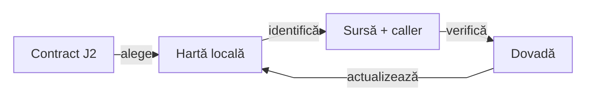

# Atlas J2 — Eventuate, Kafka, Setup și dovezi · WIP

## Pe scurt

J2 dezvoltă framework-ul Kafka/mesagerie în jurul unui singur modul de test, configurat prin scripturi Setup în Podman. Clienții și observerii Kafka Java sunt WIP; componentele locale actuale folosesc numai fixture-uri MOCK.

J2 testează contracte Eventuate și mesagerie. Începe cu sursa și callerul
indicate mai jos; extinde contextul numai când apare o dependență concretă.
J2 are șapte module și exclude UI/Debug; auditul HTML rămâne extern.

| Subiect | Intrare în cod / hartă | Invariant și limită |
|---|---|---|
| catalog și ownership | [scop J2](ATF_J2_Scope.md), [POM](../pom.xml) | 7 module fără browser; profilul rămâne Eventuate |
| request/response | [EventuateApiClient](../atf-test-eventuate/src/main/java/atf/eventuate/api/EventuateApiClient.java) | binding MOCK implicit: POST o tentativă, GET 503 cel mult două; seam separat pentru executori/politici/provenance explicite |
| snapshot terminal | [EventuateExchange](../atf-test-eventuate/src/main/java/atf/eventuate/evidence/EventuateExchange.java), [collector](../atf-test-eventuate/src/main/java/atf/eventuate/evidence/EventuateEvidence.java) | Completed sau Terminal în ordinea și faza capturării; aceeași excepție, fără răspuns inventat și fără dublarea callback-ului |
| script finit | [ScriptedApiTransport](../atf-test-eventuate/src/main/java/atf/eventuate/mock/ScriptedApiTransport.java) | ordonat, strict, fără răspuns verde când se epuizează ruta |
| convergență | [OrderAwaiter](../atf-test-eventuate/src/main/java/atf/eventuate/await/OrderAwaiter.java) | clock/pause injectate; aplică OrderContract integral la fiecare observație; un răspuns corect sosit după deadline nu converge |
| identitate business | [OrderContract](../atf-test-eventuate/src/main/java/atf/eventuate/validation/OrderContract.java) | expected independent: ID, stare și rejectionReason; decodorul refuză overflow înainte de long și păstrează limitele signed long |
| decodare comenzi | [OrderResponseDecoder](../atf-test-eventuate/src/main/java/atf/eventuate/api/OrderResponseDecoder.java) | document complet și neambiguu; integral/canConvertToLong înainte de conversie; evidence HTTP capturat înaintea decodării |
| mesagerie | [MessageEvidenceContract](../atf-test-eventuate/src/main/java/atf/eventuate/validation/MessageEvidenceContract.java) | livrări MOCK_EVENT_FEED și witness de efecte; ordinalul fixture-ului nu este offset Kafka |
| validare JSON | [Validation](../atf-validation/README.md#json--prezență-document-și-capabilități) | document complet, stări typed și schema fail-closed; egalitatea textuală cere scalar prezent, iar containerele rămân JSON în ACTUAL |
| comparație scalară | [contract](../atf-validation/README.md#egalitate-scalară--fără-coerciția-containerelor), [regresie](../atf-validation/src/test/java/atf/validation/scalar/JsonScalarEqualityContractTest.java) | aceeași regulă pentru path și fiecare proprietate din array; string gol real acceptat, containere refuzate; null textual compatibil, tipul cerut separat |
| media type JSON | [contract](../atf-validation/README.md#content-type--clasificare-semantică-json), [regresie](../atf-validation/src/test/java/atf/validation/media/JsonMediaTypeContractTest.java) | cinci contracte canonice delegă tipul/subtipul către Core C1; parametrii nu imită JSON; contains literal și validarea body-ului sunt independente |
| audit JUnit | [EventuateComponentExtension](../atf-test-eventuate/src/test/java/atf/eventuate/tests/support/EventuateComponentExtension.java) | Kit decide o singură dată; adaptorul transferă comparațiile fără reevaluare |
| raport | [ComponentReportRun](../atf-test-eventuate/src/main/java/atf/eventuate/reporting/ComponentReportRun.java) | owner serial class/suite; trei faze, close înaintea notificării căii absolute |
| infrastructură | [Setup atlas](ATF_Setup_Atlas.md) | Kafka remote și Java Windows demonstrate individual/prin două runde; revalidarea engine-ului și rutei rămâne obligatorie |
| selecție și artifact | [ghid Eventuate](ATF_Eventuate_Testing.md) | trei componente; matrice nominală de 14 artifacte, plus 36 de probe terminale individual/suită în toate fazele |
| guvernanță | [ATF Tests](../atf-tests/README.md), [catalog J2](../atf-tests/src/test/java/atf/j2/governance/J2Project.java) | inventar explicit și probe negative pentru modul lipsă, UI shadow și dependențe browser |

Reporting J7 este binarul consumat; proveniența J6 demo2 rămâne istorică, iar mentenanța bibliotecii este în atf_j0.

## Boundary-uri de fidelitate

| Schimbare | Contract și probă |
|---|---|
| mască literală și Authorization quoted/trunchiat | [Core security](../../atf_j0/atf-core/src/main/java/atf/core/security/README.md); comparație originală → redacție → preview → Extent/fallback |
| MIME și headere efective | [Core HTTP](../../atf_j0/atf-core/README.md#media-type-headere-și-vocabular-de-protocol); tip/subtip, precedență și o singură expediere |
| sursă compilabilă versus output | [ATF Tests](../atf-tests/README.md#inventarul-comun-al-surselor-java); descoperire POM separată de parcurgerea rădăcinii Java |
| import comun în J2 | [manifestul platformei](../atf-tests/README.md#proveniența-surselor-platformei-j2); bytes identici cu ownerul J1, istoric al amprentelor și gate J2 strict |

## Traseul de context

<strong>Legendă — context progresiv</strong>

Contractul și proba sunt citite împreună. Diagrama descrie ordinea investigației,
nu o dependență Maven. Pentru Reporting se citesc API-ul JAR, adaptorul local și
artifactul; implementarea este în J0, fără importarea sursei în consumer.

## Compoziție și durata de viață

1. Fixture-ul stabilește observația; testul fixează expected-ul independent.
2. API/validatorul produce fapte; Kit evaluează o dată și înregistrează faza.
3. Extensia deține scope-ul JUnit și calea raportului; main deține publicarea reutilizabilă.
4. Reporting publică Extent/fallback la close; calea absolută apare numai după publicare reușită.

Raportul comun nu partajează collectorul sau starea business a invocărilor.
Captura browser a HTML-ului este o verificare externă și nu necesită modulul atf-ui.

## Reutilizare fără mutarea politicii aplicației

- Core: transport, request, deadline și evidence neutru; fără rute sau expected-uri Eventuate.
- Kit: comparații, scope și lifecycle runner; fără renderer sau decizie business.
- Eventuate: clientul, convergența, identitățile și expected-urile produsului.
- Setup: motor disponibil, rețetă Kafka, ownership și readiness; fără verdictul saga.
- Reporting JAR: proiecție și publicare; fără reevaluarea comparației din textul redactat.

O extracție generică cere utilizări reale și același contract. Un singur
consumer MOCK nu justifică mutarea politicii Eventuate în Kit.

## Limita dovezii curente

| Dovadă | Ce demonstrează | Ce nu certifică încă |
|---|---|---|
| API MOCK | adaptor, retry și contractul răspunsului fixture | endpoint real ori comportament saga |
| clock virtual | ordinea observațiilor și refuzul PASS după expirare | SLA real sau anularea unei citiri blocate |
| witness de mesagerie | validatorul identității și al efectului furnizat | Kafka, deduplicare SQL sau proiecție Mongo reală |
| receipt Setup | pasul real executat și eroarea originală | engine sau broker doar din prezența executabilului |
| artifact HTML | populația publicată, verdict și navigare inspectate | stabilitate statistică ori toate ramurile viitoare |
| Podman remote real | client Windows → engine rootless pe gazdă; container hello-world și reutilizarea conexiunii verificate | nu certifică WSL2 în guest, listener Kafka ori saga |
| CLI Kafka real | livrări corelate și aceeași resursă după pornire repetată; producer fără exec -i | nu certifică saga sau deduplicarea business |
| client Java Setup | PASS din VM, individual și două runde; metadata verificată înainte de publish, ack și poziție corelată | nu este clientul/observerul framework-ului Eventuate; fără probă după restart fizic |
| client/observer Kafka în framework · WIP | țintă de integrare, încă neimplementată | nicio acceptanță saga sau business nu se deduce din proba Setup |

## Întreținere fără drift

Înaintea modificării recitește [feedback-ul J2](feedback/README.md), POM-ul și
proba ownerului. Source hash și [verificarea executată](ATF_J2_Verification.md)
delimitează ce rămâne relevant pentru snapshot-ul curent.

Reporting și testele sale generice sunt în J0; scenariile web și runtime-ul
browser sunt în J1. [Sync-ul selectiv](ATF_Workspace_Synchronization.md) nu
aduce înapoi aceste domenii în atlasul și backlog-ul J2.

## Core ca bibliotecă — owner și deployment

Acest consumer are 7 module sursă. Core C1 și Reporting J6 sunt biblioteci externe, câte o pereche JAR/POM direct în lib.

[Contractul Core C1](ATF_Core_Consumer.md) separă sursa, publicarea și acceptanțele J1/J2.
Testele native se păstrează în J0, iar acceptanța pe binar rulează în TMP.
