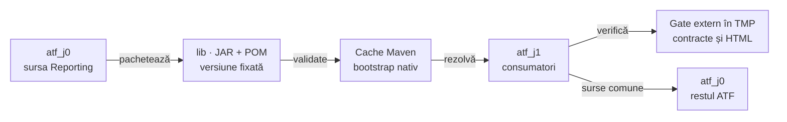

# ATF J1 — proiect principal și biblioteci consumate

## Pe scurt

Acest proiect consumă `atf.api:atf-reporting:1.0.0-j6` prin Maven.
`atf_j1` este proiectul principal pentru restul ATF-ului: modulele comune,
Shop, AutoEx și guvernanța lor. Implementarea, assets și regresiile generice
Reporting au owner în `atf_j0`; J1 consumă versiunea publicată.

**Trasee rapide:** [atlasul integrării fără sursă](ATF_Reporting_Library_Atlas.md) ·
[ownership și sync](#ownership-și-direcția-sincronizării) ·
[atlasul ATF](ATF_Context_Atlas.md).

| Suprafață | În această copie | Owner |
|---|---|---|
| Reporting producție | JAR și POM în `lib`; fără modul sursă în reactor | producătorul păstrează codul și reconstruiește biblioteca |
| consumatori | 10 module sursă; dependențele Reporting folosesc `atf.reporting.version` | J1 este sursa de adevăr pentru schimbările din afara Reporting |
| Reporting Tests | gate extern, adăugat explicit numai în TMP | `atf_j0` păstrează toate regresiile; acceptarea verifică JAR-ul înaintea distribuției |
| proveniență | un singur `library-provenance.json`, cu hash-uri și amprenta surselor | identifică exact binarul inclus |
| build și rapoarte | copie de verificare în TMP | [procesul de execuție](ATF_Build_And_Execution_Safety.md) |

Protocolul comun pentru ambele ținte este [sincronizarea J0/J1/J2](ATF_Workspace_Synchronization.md). J2 nu este încă inițializat; verificarea J1 nu îi certifică adoptarea.

## Ownership și direcția sincronizării

| Schimbare | Sursa de adevăr | Livrare către celălalt proiect |
|---|---|---|
| implementare, API, CSS/JS și publicare Reporting | `atf_j0/atf-reporting` | JAR/POM versionate, proveniență și documentație de adopție către J1 |
| regresii și fixture-uri generice Reporting | `atf_j0/atf-reporting-tests` | gate extern pe JAR în TMP, fără copie păstrată în J1 |
| Core, UI, Kit, Validation, Mock, Console, Debug UI | `atf_j1` | surse și contracte comune selectate către `atf_j0` |
| Shop/AutoEx și adaptoarele lor | `atf_j1` | schimbări de aplicație și probe, cu scope-urile producătorului păstrate |
| reactor, README principal, arhitectură și atlase | proiectul descris | ediții reconciliate; POM-ul cu JAR nu înlocuiește reactorul producătorului |

Nu se face mirror recursiv. `.git`, output-urile, cache-ul Maven și `lib` nu
intră în sincronizarea obișnuită a surselor; build-ul și verificarea rulează
în TMP, iar promovarea este selectivă și protejată față de drift.

## Traseul bibliotecii



<details>
<summary><strong>Legendă — sursă întreținută și consum binar</strong></summary>

- `atf_j0` păstrează implementarea completă, resursele și probele native ale bibliotecii.
- Folderul plat conține artifactul thin și POM-ul; bootstrap-ul rădăcinii instalează perechea în cache-ul Maven configurat.
- Consumerii compilează împotriva JAR-ului. Nu folosesc sursa Reporting dintr-un director vecin.
- Acceptanța J1 verifică binarul și integrarea sa. Regresiile generice și
  verificările structurii sursei au owner în producător.
- Muchia inversă transferă schimbările comune non-Reporting, nu configurația
  reactorului J1. Muchiile exprimă livrare, nu dependențe Maven.

</details>

## Contractul unui modul împachetat

Modulul logic nu implică sursă în fiecare consumer. Reporting este primul
boundary livrat binar; alte module pot urma numai după delimitarea API-ului,
a configurației, a lifecycle-ului și a probelor lor.

| Livrabil | Ce poate verifica independent consumerul |
|---|---|
| JAR thin și POM | coordonată, Java minim și dependențe tranzitive efective |
| documentație de adopție | intrări, erori, ownership, exemplu executabil și linkuri fără sursă obligatorie |
| proveniență | hash binar/POM, intrări ale producătorului și versiune coerentă |
| compatibilitate | suprafață susținută și migrare; accesul Java `public` nu este singur o promisiune |
| acceptanță | CodeSource și artifacte efective; probele native rămân la producător |

[Atlasul local Reporting](ATF_Reporting_Library_Atlas.md) explică integrarea
existentă. Completitudinea documentelor livrate și API-ul susținut au
[owner Reporting](feedback/ATF_Reporting_Feedback.md), fără a fi declarate închise prin această hartă.

## Deschiderea proiectului

Folderul `lib` păstrează numai distribuția inclusă în proiect:

```text
lib/
  atf-reporting-<version>.jar
  atf-reporting-<version>.pom
```

Se păstrează numai ultima versiune. Hash-urile SHA-256, amprenta snapshot-ului
producătorului și catalogul probelor native sunt în
[proveniența unică](../library-provenance.json), la rădăcina proiectului.

| Bootstrap Maven | Contract |
|---|---|
| [POM-ul rădăcină](../pom.xml) | Install Plugin fixat; `install-file` în `validate`, o singură dată, cu `inherited=false` |
| dependențe | modulele folosesc dependența Maven și `atf.reporting.version`; POM integral, cu `generatePom=false`, pentru tranzitive |
| folderul plat | distribuție locală; nu este declarat repository Maven |

Primul import folosește Maven 3.6.3+ și JDK 21. Din rădăcina proiectului:

```powershell
mvn -B -N validate
```

1. Rulează bootstrap-ul cu același Maven, settings și repository local pe care
   le configurezi în IntelliJ: Settings → Build Tools → Maven.
2. Deschide POM-ul rădăcină drept proiect Maven și folosește Reload All Maven Projects.
3. Selectează JDK 21 pentru proiect și Maven importer/runner; lansează testul
   cu classpath-ul modulului său. Nu adăuga o dependență manuală către JAR.

Un build cu `-pl atf-test-auto-ex -am` include rădăcina și execută bootstrap-ul
înaintea modulelor. Pentru o lansare Maven direct dintr-un submodul, pregătește
cache-ul prin comanda de mai sus. Schimbarea versiunii ori a repository-ului
local cere repetarea bootstrap-ului și reload în IDE.

Maven folosește repository-ul configurat în settings. Pentru izolare în TMP,
transmite același `-Dmaven.repo.local=<cale>` atât la bootstrap, cât și la teste;
IDE-ul trebuie să folosească același repository dacă validezi acel cache.
Structura cu groupId/artifactId/versiune există în cache, în afara folderului `lib`.

- În gate-ul temporar, fixture-urile identifică rădăcina prin propriul POM și
  resursa din classpath; working directory-ul extern nu cere sursa bibliotecii.
- Lipsa JAR-ului sau POM-ului local refuză bootstrap-ul chiar dacă versiunea
  există deja în cache. Un fișier omis nu se substituie printr-un artifact vechi.
- Verifică SHA-256 față de [proveniență](../library-provenance.json)
  înaintea actualizării distribuției; bootstrap-ul standard nu este un gate de semnare.

## Compatibilitatea acestui increment

`ReportAuditSnapshot.Failures` distinge cauzele de scenariile eșuate.
Constructorul cu patru argumente și simbolurile binare anterioare sunt păstrate;
un record pattern Java folosește acum cinci componente la recompilare.
Această migrare explicită nu declară compatibilitatea întregului API public.

## Reporting Tests la producător

Reporting Tests nu este modul în J1. Regresiile generice, mock-urile și
contractele rămân în [producător](../../atf_j0/atf-reporting-tests/README.md#regresia-permanentă-a-fiecărui-defect-reporting).
Fiecare JAR candidat trece gate-ul integral într-un consumer TMP cu harness-ul
adăugat explicit; probele adaptoarelor Shop/AutoEx rămân în modulele lor.

## Validarea consumerului

Comenzile se execută într-o copie TMP a acestui proiect. Bootstrap-ul și
compilarea main/test pentru cele zece module se verifică prin:

```powershell
mvn -B test-compile
```

`test-compile` verifică rezolvarea și compilarea; nu execută testele și nu
certifică suita whole-ATF copiată. Pentru regresiile aplicațiilor folosește
[Shop](../atf-test-practice-shop/README.md) și [AutoEx](../atf-test-auto-ex/README.md).

Aceeași suită whole-ATF verifică sursa cu 12 module și consumerul binar cu
10 module, prin [suprafața declarată](../atf-tests/README.md#guvernanța-deployment-ului-sursă-sau-binar).
Inventarul temporar cu harness extern are 11 module și păstrează toate controalele.

<details>
<summary><strong>Layout TMP pentru guvernanța linkurilor</strong></summary>

Păstrați perechea de directoare sub aceeași rădăcină TMP proprie:

```text
<TMP increment>/
  atf_j1/   consumerul verificat
  atf_j0/    snapshot-ul producătorului pentru destinațiile documentare
```

- Linkurile relative spre testele și documentele Reporting se verifică din
  același layout ca proiectele live; o copie J1 fără acel vecin nu certifică linkurile.
- Snapshot-ul vecin nu intră în reactor, classpath sau folderul `lib` al
  consumerului. Reporting continuă să fie încărcat din JAR-ul verificat.
- Gate-ul extern runtime al bibliotecii rămâne independent de această probă
  documentară; nu primește sursa de producție pentru a satisface fixture-urile.

</details>

## Gate-ul extern Reporting

[Reporting Tests din producător](../../atf_j0/atf-reporting-tests/README.md) păstrează
probele runtime și browser. Testele native și auditul sursei rămân la producător;
gate-ul consumerului trebuie să încarce JAR-ul fizic, cu POM-ul și tranzitivele lui.

Pentru fiecare versiune nouă, pregătește un consumer temporar:

1. Copiază proiectul J1 în TMP, fără output-uri ori cache-uri.
2. Copiază numai modulul Reporting Tests din producător în acel consumer și
   adaugă-l temporar în lista `modules` a POM-ului rădăcină.
3. În POM-ul modulului temporar folosește `${atf.reporting.version}` pentru
   dependența Reporting; păstrează celelalte dependențe și toate testele.
4. Rulează gate-ul integral, cu același repository local ca bootstrap-ul:

```powershell
mvn -B -pl atf-reporting-tests -am "-Dtest=atf.reporting.**.*Test,atf.reporting.**.*Tests,atf.ui.tests.extent.**.*Test,atf.ui.tests.extent.**.*Tests" "-Dsurefire.failIfNoSpecifiedTests=false" test
```

| Tip de verificare | Interpretare |
|---|---|
| inventar complet | clasele `Test` și `Tests` din ambele namespace-uri; identitățile Surefire se reconciliază cu sursele |
| API, modele, proiecții, renderer și browser | regresii de consum ale JAR-ului, fără omiterea failure-path-urilor |
| distribuție externă | CodeSource și SHA-256 identifică binarul; POM-ul inclus și refuzul assets lipsă sunt probate separat |
| working directory extern | fixture-ul nu cere POM-ul sau sursa producției Reporting |
| artifact și limite | audit în TAB MCP, cu timing, assertions, expandări, backlink și preview implicit 240 |

Launcherele canonice unit/component/integration/E2E pot fi folosite în consumerul
TMP; aliasurile nu se numără ca gate-uri disjuncte. Logurile, XML-urile și HTML-ul
rămân dovezi ale execuției în TMP. La încheiere, J1 publicat păstrează cele zece
module și distribuția plată; nu primește harness-ul ori output-urile validării.

## Actualizarea bibliotecii

1. Corectează și verifică Reporting în proiectul producător, cu build în TMP.
2. În copia TMP, setează versiunea POM-ului bibliotecii înaintea build-ului;
   construiește JAR-ul cu testele native și păstrează acel POM efectiv.
3. Actualizează proveniența unică și include JAR-ul/POM-ul direct în `lib`.
4. Actualizează `atf.reporting.version` și rulează probele consumerilor.
5. Verifică CodeSource-ul încărcat și egalitatea hash-ului cu artifactul inclus.

Actualizarea binarului nu copiază sursele Reporting în acest reactor.
Documentația proiectului descrie J1; regulile sursei standalone și gate-urile
producătorului sunt delimitate explicit. Acest document deține ownership-ul
și sincronizarea; [atlasul integrării](ATF_Reporting_Library_Atlas.md) deține contextul consumerului fără sursă.

