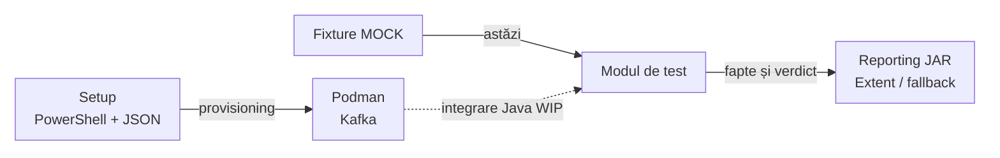

# J2 — scop, ownership și perimetrul fără browser

## Pe scurt

J2 este WIP pentru un framework de mesagerie și un singur modul de test Kafka,
cu Setup PowerShell în Podman. Reactorul are șapte module, fără UI/Debug;
cele trei componente actuale sunt MOCK, iar integrarea Kafka Java în framework rămâne de implementat.

| Stare live | Contract |
|---|---|
| catalog | Kit, Mock, Validation, Console, Setup, Eventuate, Tests, în ordinea declarată |
| profil | eventuate; foundation are alt catalog și nu substituie acest deployment |
| browser | fără surse UI/Debug și fără dependență Playwright |
| Reporting | JAR/POM J6, fără sursă ori harness în J2 |

## Limita executabilă

| Suprafață | Sursă / probă | Invariant |
|---|---|---|
| reactor | [POM](../pom.xml), [catalog J2](../atf-tests/src/test/java/atf/j2/governance/J2Project.java) | exact cele șapte identități; modul obligatoriu lipsă sau modul străin refuzat |
| dependențe | [ATF Tests POM](../atf-tests/pom.xml), [guard J2](../atf-tests/src/test/java/atf/j2/governance/J2DeploymentGovernanceTest.java) | fără atf-ui, atf-debug-ui sau Playwright |
| catalog comun | [GovernanceDeployment](../atf-tests/src/test/java/atf/api/tests/governance/distribution/GovernanceDeployment.java) | profil explicit; absența directorului nu reduce catalogul |
| documente | același resolver de deployment | țintele UI externe sunt mapate explicit la documente J2; țintele active lipsă rămân erori |
| snapshot importat | [platform-provenance](../platform-provenance.json) | suprafața J2 delimitată, fără rebazarea build-ului istoric J6 |

Core păstrează vocabularul public de module folosit și în J0/J1; eliminarea
dintr-un deployment nu justifică ruperea API-ului comun. POM-ul și catalogul
local stabilesc modulele J2, nu prezența tuturor constantelor în Core.

## Sync selectiv

- J1 deține scenariile Shop/AutoEx și runtime-ul browser; J2 preia selectiv platforma comună aplicabilă.
- J0 deține Reporting, documentația bibliotecii și regresiile ei generice; J2 consumă binarul și își verifică adaptorul.
- Setup și Eventuate au owner J2; nu se copiază automat în reactorul J0/J1.
- README-ul principal, atlasul, POM-ul și feedback-ul fiecărui deployment nu se țin identice prin mirror.

Nu restaurați UI/Debug sau Playwright prin sync. Auditarea HTML-ului în browser
este o verificare externă a raportului, fără dependență a consumerului Eventuate
către modulul atf-ui.

## Dovadă și restanțe

[Verificarea J2](ATF_J2_Verification.md) separă acceptanța retragerii browserului
de probele anterioare cu zece module. [Feedback-ul](feedback/README.md) păstrează
numai criterii deschise, fără a redeschide retragerea deja demonstrată.

## Configurarea Kafka și integrarea WIP

<strong>Legendă — infrastructură și integrare încă deschisă</strong>

Setup configurează Kafka și verifică clientul Java de infrastructură numai la lansare explicită; Maven nu pornește servicii. Muchia punctată arată clientul/observerul de implementat în framework, iar muchia MOCK arată intrarea actuală a testelor Eventuate.

Modulul de test deține expected-ul și verdictul. Reporting JAR publică faptele și HTML-ul; muchiile reprezintă operații și flux de date, nu dependențe Maven.

