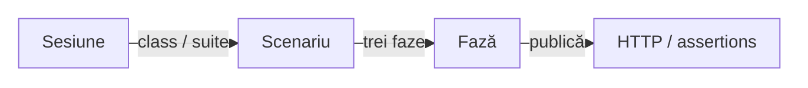

# Reporting J6 — atlasul integrării J2

Adopția curentă este J12; inventarul J6 de mai jos și delta J7 rămân istorice.
[Proba istorică J10](ATF_Reporting_J10_Verification.md) fixează independența expandărilor și ABI-ul tagurilor; [proba istorică J8](ATF_Reporting_J8_Verification.md) fixează colapsarea API; [delta J7](ATF_Reporting_J7_Verification.md) păstrează observațiile typed și limitele compatibilității.

## Pe scurt

J2 consumă atf.api:atf-reporting:1.0.0-j6. API-ul folosit mai jos este confirmat
pe JAR-ul fizic; sursa curentă J0 poate evolua fără a redefini contractul J6.

| Boundary | Owner |
|---|---|
| model, renderer și HTML | J0 Reporting |
| regresii generice, inclusiv browser | J0 Reporting Tests |
| adaptor, scope și expected-uri Eventuate | J2 |
| audit HTML | activitate externă de verificare, fără dependență atf-ui în Eventuate |

## Identitatea bibliotecii

[Proveniența](../library-provenance.json) păstrează hash-urile JAR/POM,
POM-ul publicat și originea istorică demo2. MaintenanceReference indică J0;
mutarea ownerului nu pretinde un nou build sau repetarea acceptanței istorice.

CodeSource și hash-ul clasei încărcate sunt verificate de
[guvernanța J2](../atf-tests/src/test/java/atf/j2/governance/J2DeploymentGovernanceTest.java).
J2 nu păstrează sursa Reporting sau harness-ul producătorului.

## API consumat și ownerul adaptorului

| API public J6 | Caller J2 | Contract |
|---|---|---|
| ExtentReportSession / HtmlReportSession | [ComponentReportRun](../atf-test-eventuate/src/main/java/atf/eventuate/reporting/ComponentReportRun.java) | sesiune cu setări capturate și artifact proaspăt |
| AtfReportPorts | același owner main | scenariu → fază → request/step, close al copiilor înainte de sesiune |
| AssertionAuditReport.publishStep | publicarea fazei | comparații deja evaluate, pas Component assertions |
| ReportModelAdapters.execution | [ApiEvidencePublisher](../atf-test-eventuate/src/main/java/atf/eventuate/reporting/ApiEvidencePublisher.java) | model Reporting din schimbul Core capturat |
| ReportingSettings / loader | constructorul ownerului | preview și politici capturate o singură dată |
| SensitiveDataRedactor | display și diagnostic | protecție la publicare, după evaluarea integrală |

## Arbore și scope-uri

<strong>Legendă — owner și dovadă</strong>

Sesiunea este owner serial. Scenariul și collectorul sunt per invocare;
SETUP, TEST BODY și TEARDOWN păstrează status, comparații și timing.
Un raport comun nu partajează observația sau starea business.

## Lifecycle și publicare

Extensia JUnit compune ComponentAuditExtension din Kit. Faptele sunt proiectate
în main, apoi ownerul închide sesiunea și verifică existența artifactului.
Calea absolută apare numai după close reușit, prin opt-in AtfReportPath.

## Verdict și aserțiuni

Kit compară valorile integrale o singură dată. Boolean-ul rezultat și
expected/actual de display sunt proiectate fără reevaluare de renderer.
Un assertion FAIL deja înregistrat nu produce încă un diagnostic execution identic.

## Metadata și configurație

Rendererul, output-ul și scope-ul sunt rezolvate de extensia consumerului.
ReportingSettings este capturat la owner; preview-ul implicit este 240.
Working directory-ul și output-ul sunt descrise în [ghid](ATF_Eventuate_Testing.md).

## Schimb API și identitate

Core furnizează request/response, tentative și provenance ACCEPTANCE_MOCK.
Statusul transportului și contractul comenzii sunt axe separate. Absența HTTP
în scenariul de mesagerie este legitimă și nu se repară prin request fictiv.

## Timing măsurat de caller

Faza primește timing-ul Kit. Durata HTTP vine din schimbul Core, iar
convergența fixture-ului are clock virtual; aceste valori nu sunt interschimbabile.

## Diagnostice și navigare

FAIL-ul trebuie să rămână identificabil în scenariul și faza originale.
Tests/Fails și backlink-ul sunt verificate pe raportul nou, cu Enter/Space
și acces până la ultima comparație; textul dintr-un script nu este dovadă vizibilă.

## Tabele și randare

Assertions au patru coloane: ASSERTION, EXPECTED, ACTUAL, RESULT.
Lățimea folosește spațiul disponibil și conținutul coloanelor. Fallback este
un renderer distinct, cu aceeași populație semantică, nu aceeași structură DOM.

## Redactare și previzualizare

Preview-ul 240 este limită de display, nu limită a comparației.
Mismatch-ul după această limită rămâne FAIL; JSON/body are buget separat.
Nu se trunchiază input-ul testului pentru a satisface randarea.

## Componente și raport comun

[Matricea J2](ATF_Eventuate_Testing.md) verifică 12 artifacte și patru
failure-uri intenționate, cu oracol pe tabele și mutanți negativi.
Nu certifică Kafka sau saga Eventuate reală.

## Diagnostic și handoff

J6 ReportArtifactInspector nu este un gate universal pentru assertion-only
și fallback. Receipt-ul păstrează rezultatul original; adaptorul J2 are
oracol propriu și [urmărește adoptarea](feedback/ATF_Reporting_Consumer_Feedback.md).

Defectele bibliotecii se repară în J0. O versiune nouă cere aceeași pereche
JAR/POM și acceptanță proprie a J2, fără înlocuirea binarului sub aceeași coordonată.

## Profil explicit și surse temporale

[Contractul J0](../../atf_j0/atf-reporting/README.md#inspecția-artifactului-cu-intenție-explicită) separă intenția callerului de inspecția artifactului; apelul legacy rămâne Extent/HTTP.
[Acceptanța J12](ATF_Reporting_J12_Verification.md) fixează binarul și probele consumerului, fără surse ori harness Reporting în acest reactor.
