# Reporting ca bibliotecă — atlasul integrării J1

## Pe scurt

Acest atlas permite integrarea Reporting fără sursa bibliotecii. Pornește de
la contractele consumate, callerul local și JAR-ul încărcat; implementarea,
regresiile generice și documentația bibliotecii au owner în `atf_j0`.

| Intenție | Intrare | Verifică la caller |
|---|---|---|
| publică un rezultat | [API și arbore](#api-consumat-și-ownerul-adaptorului) | observație și expected independente |
| finalizează artifactul | [lifecycle](#lifecycle-și-publicare) | close al resursei proprii/comune și notificarea căii |
| explică un failure | [diagnostic](#diagnostice-și-navigare) | cauza, faza, ordinalul și captura originală |
| alege versiunea | [identitate binară](#identitatea-bibliotecii) | proprietatea Maven, hash, POM și CodeSource |

## Identitatea bibliotecii

Versiunea este declarată în [POM-ul J1](../pom.xml); [lib](../lib) conține
numai JAR-ul și POM-ul. [Proveniența](../library-provenance.json) păstrează
hash-urile binarului/POM-ului, amprenta intrărilor și catalogul probelor native.

Amprenta identifică snapshot-ul producătorului, fără a transporta sursa ori
schimbările ulterioare din `atf_j0`. Diagnosticul pornește de la versiunea
încărcată; numele unei clase din stack trace nu implică sursă disponibilă în J1.

API-ul folosit poate fi inspectat din binar:

```powershell
javap -classpath lib/atf-reporting-1.0.0-j6.jar 'atf.reporting.contract.AtfReportPorts$Session'
```

Exemplul folosește versiunea inclusă; după upgrade folosește coordonata
din POM. Clasele `public` nu reprezintă automat suprafață stabilă pentru orice
release; compatibilitatea se verifică pentru utilizările reale.

## API consumat și ownerul adaptorului

```mermaid
%%{init: {"themeVariables":{"fontSize":"15px"},"themeCSS":".nodeLabel, .nodeLabel p { font-size: 15px !important; line-height: 1.35 !important; } .edgeLabel, .edgeLabel p { font-size: 12px !important; font-weight: 400 !important; line-height: 1.2 !important; } .edgeLabel .labelBkg, .edgeLabel p { background: transparent !important; } .edgeLabel foreignObject { transform: translateY(-18px); overflow: visible; } .node rect { rx: 6px; ry: 6px; }","flowchart":{"curve":"linear","nodeSpacing":24,"rankSpacing":40,"padding":10,"diagramPadding":16}}}%%
flowchart LR
    Caller["J1<br/>execuție + comparație"] -->|adaptează| DTO["Modele Reporting<br/>fapte + verdict"]
    DTO -->|publică| Jar["JAR<br/>Extent / fallback"]
    Jar -->|produce| Html["HTML auditabil"]
    Html -->|verifică| Proof["Probă consumer"]
```



<details>
<summary><strong>Legendă — contract binar și integrare locală</strong></summary>

- Callerul deține HTTP-ul, browserul, expected-ul și politica business.
- Modelele sunt ale bibliotecii; adaptorul conservă identitatea și valorile,
  fără obiecte Playwright sau Core ca protocol implicit.
- JAR-ul deține proiecția; schimbarea rendererului se livrează din producător.
- Muchiile exprimă date și verificare, nu module sursă suplimentare.

</details>

| Intrare binară | Rol | Caller local |
|---|---|---|
| `AtfReportPorts` | Session → Scenario → Phase → pași/request/validation | extensia JUnit și ownerul sesiunii |
| `ExtentReportSession`, `HtmlReportSession` | două renderere peste faptele publicate | alegerea output-ului și finalizarea |
| `UiExtentReportOptions`, `UiExtentReportSession` | checkpoint-uri și profil UI/API | [fabrica Shop](../atf-test-practice-shop/src/main/atf/shop/runtime/ShopRunReportFactory.java), [runtime AutoEx](../atf-test-auto-ex/src/main/java/atf/autoex/runtime/README.md) |
| `AtfAssertion`, `AssertionAuditReport` | rezultate deja evaluate | [auditul Kit](../atf-test-kit/README.md#comparații-junit-cu-dovadă-neutră) |
| `ReportRequest`, `ReportResponse`, `ReportExecutionEvidence` | exchange și execuție terminală | mapperul main al consumerului |
| `ReportEnvironmentSnapshot`, `ReportingSettings` | metadata și limite de display | composition root și configurație |

## Arbore și scope-uri

`SETUP`, `TEST BODY` și `TEARDOWN` descriu fazele existente ale testului.
Assertion-step, request, validation și captură aparțin fazei lor; nu se inventează
evidence pentru a umple arborele. Copilul se finalizează înaintea părintelui.

Un scope gol poate rămâne terminal; dovezile existente trebuie să poată fi
expandate până la comparație. Refuzul unei tranziții nu autorizează replay-ul.
[Contractul semantic](ATF_Reporting_Contract.md) descrie rezultatul cerut de ATF.

<details>
<summary><strong>Exemplu executabil — comparație furnizată de consumer</strong></summary>

```java
import atf.reporting.configuration.ReportingSettings;
import atf.reporting.contract.AtfAssertion;
import atf.reporting.contract.AtfReportPorts;
import atf.reporting.contract.AtfReportStatus;
import atf.reporting.extent.session.ExtentReportSession;
import java.nio.file.Path;
import java.util.List;

public final class LibraryConsumerExample {
    public static void main(String[] args) {
        if (args.length != 2) throw new IllegalArgumentException("Expected: output.html observed-state");
        String expected = "ready", actual = args[1];
        boolean passed = expected.equals(actual);
        var status = passed ? AtfReportStatus.PASS : AtfReportStatus.FAIL;
        try (AtfReportPorts.Session session = new ExtentReportSession(
                Path.of(args[0]), ReportingSettings.defaults());
             var scenario = session.startScenario("Consumer", "observed state is ready", List.of("component"));
             var phase = scenario.startPhase("TEST BODY");
             var step = phase.startAssertionStep("Component assertions")) {
            step.assertions(List.of(new AtfAssertion("Observed state", expected, actual, passed)));
            step.complete(status);
            phase.complete(status);
            scenario.complete(status);
        }
        if (!passed) throw new AssertionError("Observed state differs; inspect the report");
    }
}
```

Programul primește output-ul și observația; `ready` este controlul nominal.
Altă valoare produce artifact FAIL și refuz Java, după închiderea scope-urilor.
Compilarea folosește JAR-ul și tranzitivele din POM, fără module ATF suplimentare.

</details>

## Lifecycle și publicare

| Boundary | Extent | Fallback HTML |
|---|---|---|
| path | absolut și normalizat | path-ul primit de constructor |
| `flush()` | finalizează în workspace; nu promite fișierul final | scrie destinația finală |
| `close()` | închide și publică din workspace | flush final și închidere |
| thread | sesiune confinată ownerului | fără același guard; nu se deduce thread safety |

Callerul include close-ul în rezultat și anunță calea numai după publicare
reușită. Hook-ul JUnit aparține resursei proprii/comune; un refuz nu justifică
retry implicit. Cauza primară și erorile secundare de cleanup rămân distincte.

## Verdict și aserțiuni

Callerul evaluează comparația o singură dată, din expected independent și
actual observat. Rendererul conservă FAIL/SKIP și nu reevaluează egalitatea
din textul scurtat; un părinte PASS ori cleanup-ul reușit nu șterg un FAIL.

[Auditul componentelor](ATF_Testing_Guide.md#auditul-componentelor-consumerilor)
păstrează comparația și pasul standard colapsabil. Unit tests au propriul
contract, fără pași E2E artificiali.

## Metadata și configurație

`ReportingSettings.defaults()` păstrează preview-ul assertion-urilor la 240.
Override-ul este configurația efectivă; plafonul privește display-ul, nu
comparația, lungimea sursei Java ori un prompt.

`ReportEnvironmentSnapshot` furnizează System din câmpuri permise. Viewport-ul
cerut și zoom-ul configurat nu substituie măsurarea CSS/DPR a browserului;
consumerul adaptează [configurația sa](ATF_Test_Infrastructure_Annotations.md).

## Schimb API și identitate

`ReportRequest` și `ReportResponse` descriu schimbul observat; query-ul poate
avea perechi duplicate și valori goale. Mapperul conservă datele disponibile
ori amprenta opacă; URL-ul afișat nu autorizează selecția business.

La execuție fără răspuns, `ReportExecutionEvidence` păstrează attempts,
termination, provenance și cauza terminală. Nu inventa status HTTP ori durată
zero pentru o valoare necapturată; lipsa dovezii este distinctă de succes.

## Capturi și profiluri

Browserul și captura sunt ale UI/consumerului. `ReportScreenshotPolicy` și
profilul aleg ce se publică; rendererul primește captura originală, fără
navigare ori recapturare pentru îmbunătățirea retrospectivă a raportului.

UI și UI_API nu schimbă verdictul business sau politica mutației.
[Contractul capturilor](ATF_Evidence_Capture_Contract.md) descrie selecția,
starea necapturată și checkpoint-ul care deține dovada.

## Timing măsurat de caller

Măsoară execuția, capturile și publicarea la ownerii lor; agregarea request-urilor
nu este automat durata E2E. Transportă timing-ul typed, păstrând necunoscutul
distinct de zero; modelele și randarea lui rămân la producător.

[Runtime AutoEx](../atf-test-auto-ex/src/main/java/atf/autoex/runtime/README.md)
și [suportul Shop](../atf-test-practice-shop/src/main/atf/shop/support/README.md)
arată adaptoarele locale.

## Diagnostice și navigare

Eroarea înaintea checkpoint-ului păstrează faza și cauza terminală; eroarea
după PASS are diagnostic distinct. Cleanup-ul nu o înlocuiește, iar ownerul
business/comparație/execuție nu se deduce din titlu.

`Fails → Tests` deschide scenariul, faza și ordinalul dovezii originale.
Două grupuri omonime cer identitate typed; tabul vizibil singur nu certifică
expandarea. Regresia neutră aparține Reporting Tests din producător.

## Tabele și randare

[Contractul de display](ATF_Reporting_Display_Contract.md) definește coloanele,
spațiul disponibil, wrapping-ul, scroll-ul local și disclosure-urile pentru
toate tabelele: setup, assertions, Playwright actions și API.

Snapshot-ul semantic nu probează stilul calculat ori tastatura. Consumerul
verifică raportul său, iar producătorul matricea generică Extent/fallback;
harness-ul aplicației nu injectează CSS sau JavaScript de corecție.

## Redactare și previzualizare

Comparația integrală precede redacția și bugetul de display. Un mismatch după
240 rămâne FAIL fără expunerea integrală a secretului; JSON valid, input invalid
și canary-uri sensibile cer probe separate.

Eticheta redactată nu este cheia selecției request-ului. Rezultatul unui fixture
nu declară protecție universală pentru orice format sensibil; problema de
redactor ori renderer revine la producător.

## Observație și recuperare BE

UI/consumerul execută observația read-only și deține deadline-ul și politica.
Reporting primește faptele typed ori rândurile INFO adaptate; succesul observației
nu rescrie un FAIL și nu autorizează replay-ul mutației.

Operația, încercarea, cauza, bugetul și corelarea se conservă la adaptor.
Proiecția neutră are [owner Reporting](feedback/ATF_Reporting_Feedback.md);
J1 repară pierderea produsă de callerul său.

## Componente și raport comun

Kit deține evaluarea JUnit și reconcilierea rezultatului; extensia aplicației
deține resursa raportului. Un raport comun nu înseamnă browser, cont, captură
ori verdict partajate între invocări.

Verifică individual/prin suită pasul colapsabil, expected/actual, FAIL/SKIP,
finalizarea unică și calea absolută după close reușit. Probele integrației
Shop/AutoEx rămân la consumer dacă modulul generic de teste este retras.

## Diagnostic și handoff

| Observație | Verifică întâi în J1 | Ownerul corecției |
|---|---|---|
| clasă sau metodă absentă | versiune, POM, CodeSource și apelul compilat | adaptor J1 ori compatibilitate Reporting în `atf_j0` |
| raport absent | opt-in, Store JUnit, cauza close-ului și output-ul | caller J1; publisher defect la producător |
| verdict/captură greșite | expected, mapper și identitatea invocării | consumer pentru input; Reporting pentru proiecție |
| coloane ori backlink defecte | același HTML, fază/ordinal, viewport și tastatură | Reporting și regresia sa în `atf_j0` |

Handoff-ul include coordonata/hash-ul, input minim fără secrete, cauza,
expected/actual și reproducerea. [Procesul J1](ATF_J1_Consumer.md) fixează livrarea;
sursa bibliotecii și fișierele din JAR nu se repară în `lib`.
