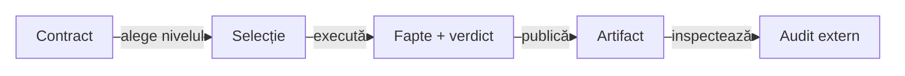

# Testare J2 — niveluri, selecții și dovezi

## Pe scurt

J2 verifică Eventuate prin componente MOCK și pregătește infrastructura Kafka.
Reporting este consumat ca JAR; auditul HTML se face extern, fără a cere modulul UI.

| Nivel | Intrare | Limita verdictului |
|---|---|---|
| unit | probele platformei | contractul primitivei; fără raport component/E2E obligatoriu |
| component | [EventuateComponentSuite](../atf-test-eventuate/src/test/java/atf/eventuate/tests/suites/EventuateComponentSuite.java) | exact trei cazuri deterministe, cu assertions colapsabile |
| guvernanță | [WholeAtfGovernanceSuiteTest](../atf-tests/src/test/java/atf/api/tests/governance/WholeAtfGovernanceSuiteTest.java) | catalog, boundaries, selecții, documente, Git și JAR fizic |
| infrastructură offline | [Setup contracts](../atf-setup/tests/Test-SetupContracts.ps1) | scripturi, configurație, ownership și proces; fără broker |
| integration reală | [Setup Kafka](../atf-setup/README.md) și clientul viitor | engine, broker și efecte reale, cu provenance distinctă |
| E2E | planul [Eventuate](ATF_Eventuate_Integration.md) | saga și efectele persistente; încă nedemonstrate |

## Traseul canonic al unei verificări



<details>
<summary><strong>Legendă — owner și dovadă</strong></summary>

Expected-ul și numărul cazurilor sunt fixate înaintea lansării. Artifactul
nu substituie execuția și nu dovedește un serviciu real când sursa este MOCK.
Auditul extern verifică HTML-ul publicat; nu partajează lifecycle-ul aplicației.

</details>

## Auditul componentelor consumerilor

Cele trei clase folosesc EventuateComponentTest, Kit și extensia locală.
SETUP, TEST BODY și TEARDOWN publică grupul standard Component assertions.

- Comparația folosește valorile integrale; redacția și preview-ul 240 sunt ulterioare.
- Verdictul, cauza și timing-ul fazei sunt păstrate; cleanup-ul nu înlocuiește FAIL prin PASS.
- Collectorul este per invocare; raportul poate avea scope class sau suite.
- Calea absolută este notificată numai după publicarea reușită.

## Owner-ul testului: business, adaptor sau infrastructură

| Owner | Ce verifică |
|---|---|
| testul Eventuate | schema/identitatea/starea și witness-ul independent |
| clientul / awaiterul | politica de expediere și observare, fără reevaluarea expected-ului din raport |
| adaptorul JUnit | colectare, scope și transferul rezultatului către Reporting |
| Setup | resurse și readiness; nu verdictul business al comenzii |
| J0 Reporting Tests | rendererul și contractele generice ale bibliotecii |

## Proba fiecărui owner de resurse

Rularea normală rămâne strict MOCK. Clock-ul virtual nu este SLA real;
un witness furnizat nu demonstrează deduplicarea pe broker sau persistența.

Scope-ul comun al raportului nu partajează scriptul, colecția de dovezi sau
starea unei invocări. O eroare la publicare rămâne observabilă în JUnit.

## Inventarul executabil după mutări și reclasificare

Inventarul actual are exact trei componente și o suită explicită. Adăugarea
unui caz cere cerință, review și reconcilierea selecției/guvernanței; nu se
schimbă nivelul sau filtrele numai pentru obținerea unui raport.

Retragerea UI/Debug este descrisă în [scopul J2](ATF_J2_Scope.md).
Directorul lipsă nu devine criteriu de skip al unui modul încă obligatoriu.

## Rulare și dovada randată

Dintr-un staging TMP pregătit cu bootstrap-ul bibliotecii și dependențele:

```powershell
mvn -B -pl atf-test-eventuate -Dtest=EventuateApiContractComponentTest test
mvn -B -pl atf-test-eventuate -Dtest=EventuateComponentSuite test
mvn -B -pl atf-tests -Dtest=WholeAtfGovernanceSuiteTest -Datf.test.heap.max=384m test
```

[Ghidul Eventuate](ATF_Eventuate_Testing.md) deține proprietățile, CLI-ul de
acceptanță și matricea celor 12 rapoarte. Testele negative cer exact verdictul
și cauza așteptate; un container failure sau un SKIP nu este succes.

## Stabilitatea secțiunilor expandabile — verificare în browser

- Deschide individualul și suita în Extent/fallback, identificând scenariul activ.
- Expandează toate fazele și dovezile până la ultimul rând; verifică cele patru coloane și lățimea disponibilă.
- Verifică FAIL-ul original, Enter/Space și backlink-ul, inclusiv mismatch-ul de după caracterul 240.
- Păstrează rezultatul inspectorului generic J6; profilul lui nu este universal pentru assertion-only/fallback.

## Criterii de finalizare

Codul, selecția și documentația sunt reconciliate cu live-ul; dovezile rămân
în TMP. [Feedback-ul J2](feedback/README.md) păstrează criteriul exact neînchis,
iar [verificările](ATF_J2_Verification.md) delimitează ce a fost executat.
