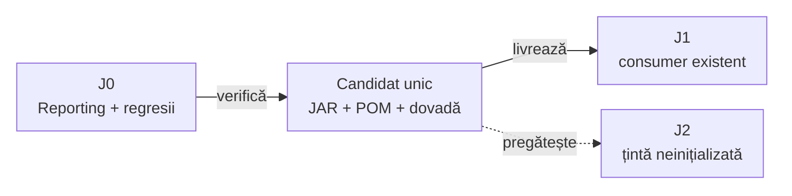

# ATF — referința J0 și sincronizarea consumerilor

## Pe scurt

`atf_j0` înlocuiește `demo2` ca referință de mentenanță Reporting.
Implementarea și toate regresiile Reporting rămân aici; fiecare destinație
primește și verifică livrarea potrivită propriului deployment.

| Workspace | Rol | Stare observată la 2026-10-31 |
|---|---|---|
| `atf_j0` | sursă Reporting, teste native și `atf-reporting-tests`; referință pentru contractele comune | 12 module sursă; guvernanța distribuției minime reconciliată cu J1 |
| `atf_j1` | consumer Reporting prin JAR; modulele și adaptoarele sale rămân locale | 10 module; J6 în `lib`, fără sursă ori harness Reporting |
| `atf_j2` | țintă suplimentară de livrare Reporting | director gol; inițializarea și acceptanța sa nu sunt demonstrate |
| `demo2` | origine istorică a livrării J6 existente | nu mai este destinație activă de mentenanță sau sync |

J1 poate avea schimbări comune în lucru. Referința J0 nu autorizează
suprascrierea lor: reconcilierea compară baza, diferența și proba fiecărui owner.

## Direcția livrării

<strong>Legendă — un candidat, acceptanțe distincte</strong>

- Sursa include implementarea, assets, probele native și regresiile cu mock/browser.
- Candidatul este construit o dată din snapshot-ul verificat; aceeași pereche
  JAR/POM este oferită destinațiilor, fără rebuild separat sub aceeași versiune.
- Muchia continuă descrie traseul existent. Muchia punctată indică o țintă
  declarată, fără bootstrap sau acceptanță deja executate.
- Muchiile sunt livrări și probe, nu dependențe Maven ori module suplimentare.

## Ce se propagă

| Schimbare în referință | Livrare către fiecare consumer | Dovadă necesară |
|---|---|---|
| Reporting Java, assets, API sau POM | versiune nouă, JAR/POM și proveniență; documentele de adopție | native, regresii permanente și gate pe JAR-ul fizic |
| numai regresii Reporting | testele rămân în J0; se verifică relevanța pentru versiunea consumată | reproducere negativă și acceptanță pe binarul afectat; fără copierea harness-ului în live |
| cod comun non-Reporting sau adaptoare Shop/AutoEx | numai sursele și probele selectate pentru același comportament | comparație cu schimbările locale și testele ownerului; un JAR Reporting nou nu este implicit necesar |
| documentație ori mutarea referinței | contracte și linkuri adaptate deployment-ului | guvernanță documentară; fără versiune binară nouă numai pentru redenumirea directorului |

- `lib` păstrează o singură versiune și numai JAR-ul/POM-ul direct în folder.
  Hash-urile și catalogul native sunt în `library-provenance.json`, la rădăcină.
- POM-urile reactorului, `.git`, bazele `testChanges`, configurațiile locale,
  cache-urile, output-urile și rapoartele nu se copiază prin mirror.
- Feedback-ul Reporting are owner în J0. Feedback-ul unei implementări comune
  se închide în alt deployment numai după sincronizarea și proba codului său.

## Protocolul fiecărui increment

1. Capturează snapshot-ul J0 și bazele fiecărei destinații; inventariază separat
   schimbările locale. Declarația unei ținte nu dovedește că ea există ca proiect.
2. Creează staging propriu în TMP. Pentru linkurile între checkout-uri, păstrează
   numele surorilor `atf_j0`, `atf_j1` și, după inițializare, `atf_j2`.
3. Repară la owner și păstrează regresia permanentă. O problemă generică de
   randare, verdict ori expandare primește probă în `atf-reporting-tests`.
4. Pentru un candidat Reporting, construiește și verifică snapshot-ul fixat;
   rulează harness-ul pe JAR-ul real în consumerul TMP. Nu construi din nou
   sursa vecină pentru a satisface contractul binar.
5. Verifică separat fiecare consumer: bootstrap Maven/IDE, tranzitive,
   CodeSource/hash, guvernanță și adaptoarele afectate. Schimbările de raport
   cer Extent/fallback, timing, assertions colapsabile, expandări și limita 240.
6. Promovează numai fișierele reconciliate prin [guard-ul Core](../atf-core/README.md#manifest-și-promovare-guarded).
   Dacă o țintă diferă de baseline, oprește acea promovare și revalidează diferența.
7. Recitește livrabilele live și consemnează starea fiecărei ținte. Un J1 verde
   nu devine dovadă pentru J2, iar promovarea per fișier nu este o tranzacție
   atomică distribuită între proiecte.

## Proveniență și relocare

| Informație | Regula de păstrare |
|---|---|
| owner curent | `maintenanceReference` indică J0 și țintele de mentenanță |
| build J6 existent | `producerDirectory`, commit-ul, hash-urile și acceptanța descriu execuția originală; nu se rescriu ca și cum ar fi rulat în J0 |
| următorul build | înregistrează snapshot-ul efectiv din J0 și acceptanțele executate, fără moștenirea automată a rezultatelor J6 |
| diferențe CRLF/LF | se explică separat; echivalența textuală nu substituie hash-ul byte cu byte al unui artifact sau al intrărilor publicate |
| controale Git | baze reale per checkout; controalele istorice nu se rebazează prin înlocuire de text |

Build-ul și promovarea urmează [procesul izolat](ATF_Build_And_Execution_Safety.md).
Restanțele de adoptare și reconciliere sunt la
[ownerul guvernanței](feedback/ATF_Governance_Feedback.md#gov-workspace-targets-77--adoptare-j0-și-acceptanță-per-destinație).
