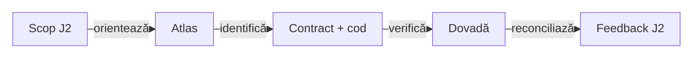

# Documentația ATF J2 — Kafka și mesagerie · WIP

## Pe scurt

Ținta este un framework Kafka cu un singur modul de test și Setup PowerShell în Podman. Kafka și clientul Java de infrastructură sunt validate din VM; observerul framework-ului este probat real, iar aplicația Eventuate completă rămâne NOT RUN.

Documentația locală explică Eventuate, mesageria, Setup și platforma consumată.
J0 deține Reporting, iar J1 deține scenariile web și runtime-ul browser.
Sincronizarea comună nu face identice atlasele sau backlog-urile deployment-urilor.

| Întrebare | Intrare |
|---|---|
| Ce aparține J2? | [Scop și catalog fără browser](ATF_J2_Scope.md), [arhitectură](ATF_Architecture.md) |
| Ce cod citesc întâi? | [Atlas J2](ATF_Context_Atlas.md), [consumer Eventuate](../atf-test-eventuate/README.md) |
| Cum construiesc laboratorul? | [Setup](../atf-setup/README.md), [atlas Setup](ATF_Setup_Atlas.md) |
| Ce demonstrează testele? | [Ghid](ATF_Testing_Guide.md), [Eventuate](ATF_Eventuate_Testing.md), [verificări](ATF_J2_Verification.md) |
| Cum adaug un test API? | [Ghid API J2](ATF_Api_Test_Guide.md), [integrare Eventuate](ATF_Eventuate_Integration.md) |
| Cum folosesc Reporting fără sursă? | [Atlas JAR](ATF_Reporting_Library_Atlas.md), [consum binar](ATF_Reporting_Consumer.md) |
| Cum folosesc SQL independent? | [SQL JDK-only](../atf-sql/README.md), [dovadă și limite](ATF_SQL_Live_Verification.md) |
| Ce mai trebuie rezolvat aici? | [Feedback J2](feedback/README.md) |
| Cum păstrez sursele live? | [Build TMP](ATF_Build_And_Execution_Safety.md), [sync](ATF_Workspace_Synchronization.md) |

## Diagramă de bază

<strong>Legendă — traseu de lectură</strong>

Scopul delimitează deployment-ul. Atlasul duce la intrarea, callerul și proba
relevante; dovada păstrează diferența MOCK/real. Feedback-ul conține numai criterii
neînchise și referințe către ownerii externi.

## Contracte comune

[Cod și OOP](README_Atf_CodeBestPractices.md) · [stil documentar](README_Atf_DocumentationBestPractices.md) ·
[adnotări Kit](ATF_Test_Infrastructure_Annotations.md) · [evidence J2](ATF_Evidence_Capture_Contract.md) ·
[raportare](ATF_Reporting_Contract.md) · [display](ATF_Reporting_Display_Contract.md).

[Baseline-ul testChanges](ATF_Test_Changes_Baseline.md) păstrează controalele
eligibile ale diferenței Git; nu este un backlog de funcționalități J2.
Nu se șterg controale doar fiindcă o cerință a fost implementată.

## Owneri externi

- [J0 Reporting](../../atf_j0/docs/feedback/README.md): implementare, renderer, documentele bibliotecii și regresii generice.
- [J1 web și platformă](../../atf_j1/docs/ATF_Context_Atlas.md): Shop/AutoEx, UI și Debug UI.
- Designul AI și extinderile browser nu fac parte din planul activ J2.

Două ținte documentare de compatibilitate rămân până la reconcilierea
guvernanței; ele trimit către J0 și nu dublează backlog-ul producătorului.

## Core ca bibliotecă — owner și deployment

This consumer has 5 source modules. Core, Reporting, Console, Mock and Test Kit are external libraries, one JAR/POM pair each directly in lib.

[Contractul Core](ATF_Core_Consumer.md) separă sursa, publicarea și acceptanțele J1/J2.
Testele native se păstrează în J0, iar acceptanța pe binar rulează în TMP.

## Library identity and release evidence

The [current library provenance](../library-provenance.json) records the delivered pair and its dated acceptance. The latest Reporting verification stays beside the producer package under [evidence retention](ATF_Workspace_Synchronization.md#release-evidence-retention); project documentation retains stable contracts.
