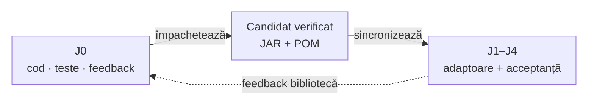

# Biblioteci ATF — consum în J2

## Pe scurt

J2 reutilizează Core, Reporting, Console și Mock prin JAR-uri; J0 deține codul și feedback-ul tuturor celor patru biblioteci. Proiectul păstrează SQL, Setup și mesagerie Eventuate · WIP, adaptoarele, configurația și oracolele independente.

## Cod și feedback

| Bibliotecă | Codul întreținut în J0 | Backlog canonic în J0 |
|---|---|---|
| Core | `atf_j0/atf-core` | `atf_j0/docs/feedback/ATF_Core_Feedback.md` |
| Reporting | `atf_j0/atf-reporting` | `atf_j0/docs/feedback/ATF_Reporting_Feedback.md` |
| Console | `atf_j0/atf-console` | `atf_j0/docs/feedback/ATF_Console_Mock_Feedback.md` |
| Mock | `atf_j0/atf-mock` | `atf_j0/docs/feedback/ATF_Console_Mock_Feedback.md` |

Căile din tabel sunt raportate la directorul comun al proiectelor. Pentru orice problemă de bibliotecă, se actualizează direct criteriul potrivit în registrul J0; indexul local păstrează doar trimiterea și acceptanța consumerului.

## Fluxul de lucru



<details>
<summary><strong>Legendă — implementare comună, acceptanță separată</strong></summary>

- Săgețile continue descriu livrarea unui candidat; săgeata punctată întoarce constatările la J0.
- J0 deține remedierea comună și regresia permanentă. Consumerul furnizează reproducerea și verifică integrarea binarului în propriul domeniu.
- Diagrama descrie responsabilități și livrări, nu module Maven suplimentare ori copierea surselor în consumeri.

</details>

## O singură cerință, cu dovezi

- Consemnați în J0 proiectul, coordonata/hash-ul efectiv, selecția/profilul, rezultatul așteptat și observat, reproducerea minimă și dovezile păstrate.
- Dacă originea este neclară, păstrați o singură constatare neconfirmată în J0 până la izolare; nu copiați checklist-ul în fiecare proiect.
- Regulile de business, capturarea Android, modelele ASR și infrastructura brokerului rămân la ownerul consumerului. Un task demonstrat exclusiv local se mută acolo cu o trimitere scurtă din criteriul inițial.
- Închideți criteriul numai după controlul negativ, regresia corectată și acceptanța relevantă; păstrați contractul stabil în documentație, fără ToDo-uri rezolvate sau cronologii de release.

## Sincronizare și guvernanță

1. Comparați codul live și schimbările locale înainte de modificare; păstrați bazele Git și configurația fiecărui proiect.
2. Corectați în J0 și adăugați regresia permanentă la owner; construiți și verificați sursa/JAR-ul într-un staging TMP propriu.
3. Distribuiți același candidat către consumerii afectați: o pereche curentă per bibliotecă, cu proveniența actualizată și istoricul original păstrat.
4. Revalidați independent fiecare consumer și promovați selectiv prin guard-ul Core. Un rezultat din J1 nu devine automat dovadă pentru J2, J3 sau J4.

| Control | Contract |
|---|---|
| Inventar consumer | Exact patru perechi JAR/POM și acest README, direct în lib; fără versiuni suplimentare, depozit imbricat sau note de release. |
| Identitate | Coordonate din POM; hash-uri și proveniență la rădăcină; POM-ul încorporat coincide cu perechea publicată. |
| Încărcare | CodeSource indică JAR-ul fizic; sursele paralele și harness-urile native nu revin în consumer. |
| Teste | Native și regresii generice în J0; contractele de adopție și acceptanța domeniului rămân locale, cu oracole independente. |
| Raportare | Preview implicit 240, assert-uri auditabile și colapsabile, cadre complete; proba mock/componentă nu certifică un device, broker sau ASR real. |

Într-o copie TMP, porniți din rădăcina consumerului și folosiți același repository Maven ca IntelliJ:

```powershell
mvn -B -ntp -N validate
mvn -B -ntp -pl atf-tests -am -Dtest=PlatformLibraryContractTest,PlatformLibraryIntegrityTest -Dsurefire.failIfNoSpecifiedTests=false test
```

[POM](../pom.xml) · [Proveniență](../library-provenance.json) · [Contract tehnic](../docs/ATF_Platform_Libraries.md)
